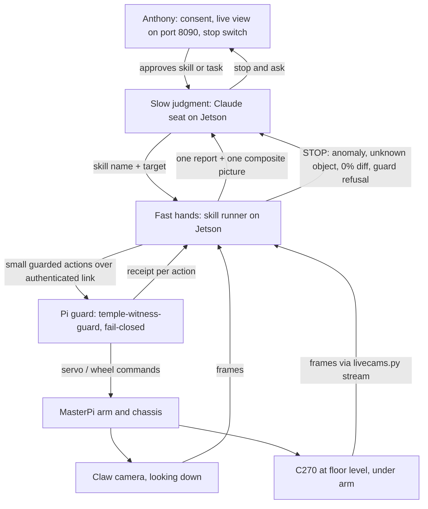

# Motion Skills Spec: Fast Hands, Slow Judgment

**Authors:** Anthony J Vasquez Sr, with Claude (co-author). Drafted by a Claude web research seat on 2026-10-15 from Anthony's brief; verified and corrected against this branch by HQ (Claude Fable 5.1, Mac Studio Claude Code seat) the same day.
**Status:** Proposal. Documentation only. Nothing here changes code, deploys anything, arms the robot or moves it.
**Branch:** prep/pi-guard-service (verified at 67f12fd)
**Reviewer:** HQ

**Verification status.** The drafting seat could not open the repo and tagged every repo-specific fact for checking. HQ checked each one against the branch at 67f12fd on 2026-10-15 and against the opus-02 notes on the Jetson. Where a file disagreed with the draft, the file won and the text below is corrected. Two kinds of tag remain: **[opus-02, Jetson only]** marks a figure whose source is the opus-02 notes under `jetson:~/witness-opus-notes/opus-02/`, which are not yet in this repo; **[re-measure]** marks a figure that no record carries yet. Appendix A lists every check with its file and line.

## 1. Problem

Today a large Claude model sits inside every tiny arm move. One batch is usually one joint, one small step. Each batch requires:

1. a status read within 2 s;
2. a battery check;
3. a runtime systemd override at `/run/systemd/system/temple-witness-guard.service.d/commissioning.conf` that changes `ExecStart`, plus a guard restart to arm (PASSDOWN.md, section on the 10-13 cleanup);
4. the action;
5. capture of both camera frames;
6. Claude reviewing both frames before choosing the next move;
7. cleanup in a `finally` block: stop, disarm, remove the override, restore the normal `ExecStart`.

Anthony approves each step at the switch.

**Measured cost:**

| Session | Date | Batches | Result |
|---|---|---|---|
| opus-01 | 2026-10-13 | 82 batch entries in `receipts/opus-01/session.json` (98 receipt files in `receipts/opus-01/batches/`, dry runs and drive pulses included) | Green held on the fourth grasp attempt (20:16 EDT); the first stack attempt dropped it beside red; regrabbed at 20:35; first stack (green on red) at 20:42 EDT |
| opus-02 | 2026-10-14 | 65 batch receipts on the Jetson (two dry: A1-dry and G3-dry; 63 real), receipt `at` stamps 21:29:02 to 22:34:26 EDT **[opus-02, Jetson only]** | No stack. Halted half-awake once for an unknown object at the C270 lens; claw camera out of focus until refocused mid-session; jaws landed short on every grasp |

That is roughly one minute per batch. Most of the minute goes to ceremony and model review, not motion. Guard restarts were also where most "serial ownership changed" startup refusals happened (four in opus-01, three of them on the connect right after an override restart). The scanner fix (7a12d2e, release 20261013-scanner-01) is live on the Pi (`receipts/scanner-deployed.json`). PASSDOWN.md calls the existing scripts evidence, not a production commissioning API (line 400), and lists making the commissioning harness dependable as the first follow-up (line 470).

The worst cost is a lesson that cannot be checked. On Oct 13, Anthony saw with his own eyes that the jaws land about 2 in (5 cm) short of the claw camera's aim point, toward the robot (`receipts/opus-01/LEARNING.md`, GROUND TRUTH 20:1x; a by-eye figure, never measured). On Oct 14 the offset WAS applied (forward pulses D4 to D6 were the recipe's offset step) and was insufficient: the jaws still closed in front of red at G35, the elbow lowering pulled them further back, and the claw camera had been re-aimed in its mount mid-session, so "centred" no longer meant what the Oct 13 numbers meant (Appendix B, items A3 and A4). Promoting the 2 in to config would not have saved the night. The lesson is that a constant is valid only under the configuration it was measured in (camera mount, pose family, elbow state), and config has to know when that configuration changed.

## 2. Architecture

Three layers, each with one job:

- **Fast hands (Jetson, code, no LLM):** deterministic skills. Each runs its own closed loop: command a small move, grab fresh frames, measure, decide the next small move or stop. These checks run continuously inside the skill.
- **Slow judgment (Claude seat on the Jetson):** chooses the skill and target ("grab green, stack on red"). After each skill it reads one short report and one composite picture, then decides the next skill, or stops and asks Anthony. It handles anything anomalous.
- **Safety floor (Pi guard, unchanged in this spec):** fail-closed, disarmed by default, battery floor 7000 mV (`companion/pi/service.py` default), wheel duty limit 0 (`deploy/hardware-locked.json`, installed as `/etc/temple-witness/hardware.json`, enforced in `companion/pi/hardware.py`), all four vendor units masked (DEPLOYMENT.md, "Vendor retirement and boot behavior"). No automatic action retry (PASSDOWN.md line 468), no replay of historical runners (line 402), a receipt for every action, and finally-block cleanup.

**Why this split.** Published LLM-robot systems keep the language model above a set of skills. SayCan grounds an LLM in a library of skills, each with a policy and a short language description, and scores what is feasible. Code as Policies has the LLM write programs that call perception outputs and control-primitive APIs. Inner Monologue returns success-detection and scene-description feedback to the planner after each skill. VoxPoser has the LLM compose objectives that a motion planner then executes in closed loop. Bin Xu's survey "AI Agent Systems: Architectures, Applications, and Evaluation" (arXiv:2601.01743) states the reason: "Real-time control imposes strict timing constraints that LLM inference cannot always meet." Its recommended pattern is "hierarchical orchestration: a high-level planner maps language goals to skill plans... and specialized controllers execute primitives under constraints." The same survey says hard constraints "must be enforced regardless of language intent". Here, that is the Pi guard's job.

**What this does not change.** The Pi guard's code, limits and defaults. The authenticated link. Anthony's ownership of motion consent.

## 3. Skill catalogue

### 3.0 Rules every skill follows

- **Fresh frames only.** Read the newest frame. Never act on a buffered one. OpenCV capture can queue stale frames when processing is slower than the camera. Refuse frozen frames, as the opus-01 and opus-02 runners already do (opus-01 G29 stopped on "stale claw frame").
- **C270 warm-up.** Discard the first 15 to 30 frames, which are black during auto-exposure. Then require mean brightness above a floor (opus-01 lowered the floor from 20 to 8 after a false dark stop; warm-up black reads about 2). Manual exposure control on Logitech webcams through OpenCV is unreliable on several platforms, so check brightness instead of trusting a setting.
- **Motion witness.** Every commanded joint move is followed by a claw-camera diff computed by a stated method (grey absdiff above 30 at the frame's own resolution, no blur), and the method is stored with the number. A held or blocked joint reads a small number, not 0%. At the opus-04 claw mount, on lit 640x480 frames, three commanded steps that moved nothing (G3 s2 2.79%, G4 s1 1.61%, G15 s1 0.92%) and one elbow wake the claw could not see (W2 s1 1.20%, see 3.2) read 0.92% to 2.79%, while the 25 real joint moves read 50.83% to 81.13% (`calibration-witness.txt`; measured on 49 within-batch stage pairs and 82 consecutive pairs, recomputed from the frames by the Jetson seat). **A diff below the STOP floor after a commanded move, on a valid witness, is STOP** (stall, contact or backlash), never progress. The floor is a percentage set inside that gap: 10% for opus-04 (the gap's geometric midpoint is about 11.9%), tuned on the same night with no true holdout, and re-derived after any mount, focus or lighting change. The only cross-check is the runner's own comment that opus-02 after the refocus had moves of at least 15.4% (a 1.5x margin; not re-derived). It would be falsified by a lit, sharp, stalled step above the floor, or a real move below it. A stall is about reversals, not step size: G14 shoulder +50 (same direction as G13) read 52.08% and moved the rug 74.6 px; G15 shoulder -50 (a reversal) read 0.92% and moved it 0.0 px (`MEASURED.md` sections 4.1 and 5.1). A literal "0% is STOP" rule fires on none of the three stalls, which read 0.92% to 2.79%, not 0%. Elsewhere in this spec, "0% diff" means "below the STOP floor on a valid witness".
- **A diff above the floor is not proof of motion by itself.** With nothing commanded, static claw pairs read 0.65% to 77% raw under auto-exposure (`G3-claw-stage-2.jpg` to `G4-claw-before.jpg` reads 77.0% while the frame mean goes 64.6 to 109.5). Where the scene should be unchanged (between batches, a held pose), rug registration (inlier fraction, shift, scale) is the second opinion: it called 25 of 26 clean static pairs static, against 10 of 26 for a 5% raw threshold and 0 of 26 for "always moved" (`controls.py motion`, measured, re-run by the Jetson seat). One pixel of shift reads 16.5% raw, and an exposure gain of x0.5 to x2.0 with no motion reads 40.9% to 81.8% (`controls.py mutants`).
- **Motion witness exceptions.** A base wake to its last commanded value (opus-03 A4: no gravity load, about 0.6%). The gripper, which the global diff cannot witness: W5 4.43%, G10 17.39% and 16.16%, G20 s2 6.33%, G22 0.86% to 1.38%, overlapping the non-move range; witness it by tip position or band (see 3.7). The earlier grasp close-step exception ("0% means the jaws met the block") is withdrawn (see 3.7).
- **Witness validity.** Before a diff is judged, both claw frames must pass a luminance gate (mean of the darker frame at least 30) and a sharpness gate (Laplacian variance at least 50; see the claw sharpness floor in 3.1). A frame that fails is "witness invalid": it is not a stall and it is not progress. A skill that is not a retreat stops on an invalid witness and asks. A retreat or park batch may continue only with an explicit flag recorded in the receipt (`--retreat` in the opus-04 runner draft), relying on the commanded poses and on rug registration where it still registers. The C270 brightness floor of 8 does not stand in for this gate: it passed every frame of the dark opus-04 park (G22: C270 means 22.6 to 27.5, claw means 7.6 to 18.1, lit claw frames at least 64.6). In that dark, real moves read 8.21% to 13.11% raw, so a floor tuned on lit frames would have stopped the park at stage 2 (8.21%, a real elbow +100 that the rug registered at -44.8 px on 34 inliers; `MEASURED.md` Table 3a), and sharpness did not catch the dark (73.7 to 380.8). [Measured, one dark episode. The 30 is the middle of an empty gap: no recorded frame lies between mean 18.1 and 64.6, so it is not a measured edge, and a dim but lit room could read 18 to 64 and be refused wrongly. Re-derive after any lighting change.]
- **Step budget.** Every skill has a maximum number of moves and a maximum wall time. If it runs out of either, it stops and reports. It does not keep trying.
- **No retry of a refused action.** If the guard refuses or errors on an action, the skill stops at once. A closed loop issues new moves computed from new frames. It never re-sends a failed command. (Whether closed-loop stepping fits the "no automatic action retry" rule in PASSDOWN.md is an open question for Anthony. See section 9.)
- HQ rulings (2026-10-17, operational, not Anthony's gate): (a) A reversal-aware backlash guard refuses by default; the runner's 100 us default stands until a held-out measurement replaces the one-session 58 us fit. (b) A rerun with `--scene-ok` or `--backlash-ok` is not an automatic retry under the guard rule: the software re-sent nothing, a human issued a new command with a recorded override, and the refused receipt (`<BATCH>-refused.json`) is kept beside it. The receipt must state why the override was given. Two overrides of the same refusal in one session is a stop and ask Anthony, because a false refusal that teaches the operator to add the flag every time defeats the gate.
- **Backlash guard (opus-04 runner draft).** Before the guard key is read or the robot contacted, the runner refuses a shoulder or elbow reversal under 100 us, using the last commanded direction per joint from the receipt chain ordered by `at`; override `--backlash-ok`. On replay it refuses exactly G4 s1, G15 s1, G17 s1 and G19 s1 and passes the exactly-100 reversals (from the seat's notes, not re-verified by HQ). Two of the refused reversals worked (G17 s1, G19 s1) and two moved nothing (G4, G15), so the line sits between them on one session's data. Nothing here has run on the robot; the first live call of the new runner is `--dry`.
- **Unknown object means stop and ask.** Any significant blob near the arm in either camera that is not a known block colour stops the skill: hands, socks, toys, anything. The skill does not try to classify it. This keeps the operator call that halted opus-02 half-awake for a plush toy at the C270 lens, which could have been a child's foot.
- **Scene-change refusal.** Before any move, the runner scores how much of each camera's frame changed since its own previous final frame, with a shift-tolerant, exposure-invariant measure (block normalised cross-correlation, label overlay masked); a large change the runner did not command (something entered the scene) is a stop. A raw pixel diff is not usable: G3 to G4, where nobody touched anything, reads 77.0% raw, against 60.6% for G1 to G2, where things were moved by someone in the room (a long green toy beside red and red squared to the camera, by eye; the rug registered -9.6, +6.1 px at x0.978, so the arm or chassis was touched too; G2 ran anyway). Refuse when 20% or more of the blocks changed on either camera. A refusal writes `<BATCH>-refused.json` and never `<BATCH>.json`, so the rerun is not blocked by "No replay"; the override is explicit and recorded (`--scene-ok`, see the HQ rulings above). Limit: this is a gross-change detector (it flags a change covering about a fifth of a frame), not a "hands clear" check. A block repositioned and rotated between W5 and G1 scored 9.0% (claw) and 11.5% (C270) and was not flagged. Over 33 consecutive opus-04 pairs it flags G1 to G2 (51.0 claw, 40.0 C270) and G21 to G22 (lights out, 94.7 and 78.5); every other pair is at most 9.3 claw and at most 5.0 C270, except W5 to G1 (`calibration-witness.txt`). [Measured: two positives, 31 negatives, one known miss; threshold near the geometric midpoint of 9.3 and 40 (19.3); no held-out set. The runner agent reports a held-out clean-looking opus-02 pair at 19.2 against the 20 line, so false refusals are plausible on other data (reported, not reproduced).] Proposed by the opus-02 seat after the plush toy. Status: implemented in the opus-04 runner draft (`witness.py`, `run_batch.py`), replayed on recorded frames, not run on the robot. Nothing here has run on the robot; the first live call of the new runner is `--dry`.
- **No blind close.** The gripper never closes unless the grasp-range check passes. And the jaws are opened to 2000 before every final approach: opus-01's tower attempt caught jaws left at 1800 after a release, which a 45-degree block's diagonal (about 4.2 cm) may not clear.
- **Receipts.** Every action gets a guard receipt. Every skill writes one skill receipt: inputs, constants used (with config version), each step's command, diff %, gate results, stop reason and the composite picture path.
  - The receipt's `at` is the only clock. Authorization text records the human's words; a clock time written inside it is the seat's estimate and is never used to order events. Across the 34 opus-04 receipts, 13 authorization strings quote a time later than their own `at` (+0.2 to +13.5 min; nine by more than 3 min). [Measured, 34 receipts.]
  - Each diff % is stored with its method (threshold, resolution, blur) and the frames' luminance and sharpness, per stage. No opus-04 batch JSON holds a diff; the seat read them from the frames afterwards.
  - The readback in a receipt is the Pi's last-commanded store (`physical_angle_measured` is false), not an angle. The chain check (start equals the previous `locked_readback`) held on all 33 opus-04 boundaries; it proves the typed start was consistent, not that the arm was there: G15 (shoulder -50) never moved the arm, so D6's receipt `start` says 2146 while the arm hung at 2196 (`G15.json`, `D6.json`, `MEASURED.md` section 5.1). There is still no angle measurement at all.
- **Constants come from config.** No measured number is hard-coded in a skill. See section 6.

### 3.1 Measured constants the skills encode

Verified against `receipts/opus-01/LEARNING.md` unless marked otherwise. Rows and figures marked **opus-04** come from the Jetson seat's 2026-10-16 session (Appendix C) and carry their own tag: *measured* (computed from receipts or frames by a named script), *by eye*, or *inferred*. Every cm figure from opus-04 is **inferred (assumed f*W: focal 554 px, 3 cm cube, +-15%)**; pixel numbers and ratios are not. opus-04 pixel figures are claw 640x480 or C270 640x360, on claw mount v3 (the fingerprint `mount_v3` in the Jetson seat's `arm_skills.yaml`), and are void if the claw mount moves (the mount fingerprint row below).

| Constant | Value | Used by |
|---|---|---|
| Servo channels | 1 gripper, 3 wrist pitch, 4 elbow, 5 shoulder, 6 base yaw (CAPABILITIES.md line 32; `receipts/vendor-mapping-facts.json`, where roles 3/4/5 are inferred from the installed IK equations and 6 is explicit in source). **There is no wrist roll on this arm.** | all |
| Pulse range | 500 to 2500 us nominal on channels 3 to 6 after the software offset (`companion/arm_lift.py`, `vendor-mapping-facts.json`); the opus-01 runner refused shoulder 2516, so 2500 is the runner ceiling too | all |
| Wake order | ~~shoulder, elbow, base, gripper, wrist~~ (the opus-01 order, superseded). **shoulder, elbow, wrist, base, gripper**: both complete wakes on record used it (opus-03 A1 to A5, opus-04 W1 to W5), each from readback 0, one joint per batch [measured, n=2] | wake_arm |
| Base gain | +50 us moves the claw view about 65 px right (high, full-res). **[void_mount: opus-01 claw geometry; the claw camera was tilted in its mount on Oct 14, left jaw tip at gripper 2000 moved from x=41 to x=112 px (Appendix B, A3); re-derive]** opus-04, mount v3: +100 us moves the claw view 118.6 px right at the high pose (1.19 px/us); reversal play about 0 (-3 +-10 us) [measured, `d2_joints.py`, G1 +118.6 px, G12 s2 -122.1 px] | center_on |
| Yaw gain vs height | about 2.4 px/us full-res when low (shoulder 2496), about 0.65 px/us high; re-measure after every height change. opus-02 after the re-aim: about 1.9 px/us low (G27), about 1.0 high (G7) **[void_mount for the opus-01 values]** | center_on |
| Shoulder gain | +100 us moves the view about 45 px up and the gripper lower; about 2 cm per 100 us and it pulls the gripper back **[void_mount for the px figure; the 45 px is void at mount v3]**. opus-04, mount v3: +100 us moves the claw view 149 to 154 px up (scene x1.10 to x1.12) at the low pose (shoulder 2146 to 2196, wrist 1382), and 148 to 216 px across shoulder 1846 to 2346 [measured, `backlash.py`, `seg.py`]. Three cm figures, not one: descent (vertical) 2.3 cm per 100 us [inferred]; pull-back toward the robot 1.5 cm per 100 us (next rows) [inferred]; the opus-01 "about 2 cm" [opus-01 figure, unmeasured at mount v3] | approach |
| Shoulder play (opus-04, new) | 58 +-5 us on a reversal: a reversal step under about 60 us moves nothing, a same-direction step moves 1:1. The first step after a reversal should be at least 75 us. [Inferred: a model fitted to 12 steps from one session (fit 57.8 us, leave-one-out 51.2 to 59.5; per-reversal lost travel 60.1, 58.9, 58.2, 51.2, 52.9, 50.1 us at G11 s1, G13, G16, G17 s1, G18, G19 s1), p < 0.005 against 200 shuffles, `backlash.py`, `controls.py permute`. G16 and G18 fit only if the arm was really at 2196 after G15: evidence, not proof] | approach, place_on |
| Shoulder pull-back (opus-04, new) | lowering the shoulder moves the held block toward the robot 1.5 cm per 100 us of gear travel (p5 to p95 1.05 to 2.0). Held red C270 width 202.3 px (sd 0.7, n=6) at gear 2104 and 243.1 px (sd 1.1, n=7) at 2196: 1.38 cm nearer over 92 us [px measured; cm inferred, `d1_pullback.py`, Monte Carlo 1.49 cm per 100 us] | place_on, approach |
| Elbow gain | +100 us moves the view about 120 px up; elbow+ also pulls the gripper back toward the robot **[void_mount for the px figure]** | approach |
| Elbow hard stop | an elbow decrease stalls near 1950 to 2000 us at shoulder 1846 (opus-02 G3, G16, G39; opus-01 G9); holding a command past it is stall load (42 mV drop across G3). Never command past it; unload on 0% at the stop **[opus-02, Jetson only]** | approach, place_on |
| Wrist gain | +100 us moves the view about 110 px down (jaws tilt outward); C270 jaw barely moves **[void_mount for the px figure]**. opus-04, mount v3: +100 us moves the view 94 to 107 px down (G6, G8 s1, G8 s2: 93.5, 107.2, 98.7), the scene scales x0.965 to x0.981, and the standing target shrinks (x0.93 to x0.95), so the wrist slides the target down the frame without bringing it closer; the C270 jaw pad rises 25 to 50 px [measured, `d2_joints.py`; the C270 jaw figure by eye] | approach |
| Reach | vertical-gripper reach at block height about 12 cm from base | locate_blocks, approach |
| Elbow backlash | about 100 us or more under load on reversal (G8/G9: 200 us of decrease with 0% change); an elbow number from another pose, neither confirmed nor refuted by opus-04. opus-04: at shoulder 2046, wrist 1082 the elbow does not go below 2253 (G3 s2 -50 and G4 +50 both moved 0.0 px, `d2_joints.py`); a stop at 2253 to 2259 or play, undecidable from frames [measured px; the stop-or-play reading inferred] | approach, place_on |
| Aim offset | jaws land about 2 in (5 cm) short of the claw aim point, toward the robot (Anthony's by-eye figure, Oct 13, never measured); opus-02 saw more than 2 in at some base/wrist settings, under a different claw mount **[opus-02, Jetson only] [re-measure]** | approach |
| Grasp point vs wrist | wrist 782 (vertical): image centre; wrist about 1200 (tilted): near the bottom, between the jaw tips **[void_mount]** | center_on, approach |
| Claw mount fingerprint | the jaw-tip pixel positions at a fixed gripper value (the claw camera is rigid with the jaws). Stored in `config/arm_skills.yaml`; every skill's preflight compares it, and drift past tolerance voids every claw-view constant and stops the skill (Appendix B, A3) | all claw-view skills |
| Close steps | 2000, 1800, 1600, 1400; runner gripper floor 1400 | grasp |
| Open range | 1400 to 1800 on release; open to 2000 before a final approach | release, grasp |
| Jaw-angle rule | the block's faces must be roughly parallel to the jaws; a corner-first close pivots the block out (0 of 2 on rotated blocks, 2 of 2 square) | square_block, grasp |
| C270 straddle dead zone | two samples, not a boundary: G42 (red about 2.5 in from the lens, overlay sharpness 30) was decidable and failed on evidence; G44 (about 1 in, sharpness 16) was undecidable. The boundary lies between, unmeasured. The C270 straddle read is a 2D projection; a jaw in front of a block can look beside it (G31 to G35). Record the overlay sharpness per frame as a cheap "too close to judge" proxy **[re-measure]** | grasp |
| C270 warm-up | first 15 to 30 frames black | all C270 reads |
| Drive pulse | duty 20, 0.5 s: the log says about 2 in on the rug; the frames' own pixel numbers, under an assumed C270 focal length, say about 3 in per pulse (Appendix B, A5). ~~Travel per pulse is unknown to within 2x~~ (superseded by opus-04 for this rug). opus-04, seven attended pulses at duty 20: 0.25 s advances the chassis 1.03 +-0.13 cm (0.41 in, five pulses); 0.5 s advanced 3.57 cm (one pulse, 3.5x, not linear); a 0.2 s pulse with a held block at another block's near face pushed it (D6) [inferred (assumed f*W), `d4_drive.py`, from the C270 line-of-blocks magnification and the claw rug shift]. The front ultrasonic (sonar) was not enabled; see 3.12 | attended drive only (see 3.12) |
| Battery drop under arm work | about 115 mV over 9 batches, 235 mV over 26, 291 mV over 50 **[opus-02, Jetson only]** | session budgeting |
| Battery (opus-04, new) | 8020 mV (W1 pre-flight) to 7648 (G21 pre-flight) over 33 batches in 33 min, then 7488 at the G22 pre-flight, 38 mV above the runner floor of 7450 (`run_batch_v1.py` line 30; the guard floor is 7000). Budget by the pre-flight reading, not by batch count [measured, `phases[preflight_ok].battery` in `W1.json`, `G21.json`, `G22.json`] | session budgeting |
| C270 scale (opus-04, new) | Z = 1662 / width_px for a 3 cm block, from an assumed focal length of 554 px at 640 wide [inferred (assumed f*W: focal 554 px, 3 cm cube, +-15%)] | every cm figure above |
| Sonar LEDs | the sonar module's RGB LEDs tint the rug blue and break colour reads (opus-01 stack attempt 1; the vendor's own colour demo turns them off first). `sonar_rgb` is an allowed output (`companion/pi/hardware.py` line 40; action schema in `companion/controls.py`). Off in every skill's preflight, before any colour threshold | locate_blocks, all colour reads |
| Claw sharpness floor | a 0% diff on a blurred claw frame is not a held joint: opus-02's first half ran at Laplacian sharpness 3.5 to 4.3 against 93 at the same pose the night before, and real moves read 0%. The motion witness is valid only above a sharpness floor (about 50 proposed) **[opus-02, Jetson only] [re-measure]** | look, every motion witness |

### 3.2 wake_arm

- **Inputs:** none.
- **Preconditions:** guard reachable; battery check passes (with the freshness rule in section 4); both cameras live and not frozen; no unknown object in view.
- **Closed loop:** joints sag when unpowered. Wake one joint at a time in the order shoulder, elbow, wrist, base, gripper (both complete wakes on record used it: opus-03 A1 to A5 and opus-04 W1 to W5, each from readback 0 to the stored pose 1=2000 3=1082 4=2353 5=1846 6=1520, one joint per batch; measured, n=2; the opus-01 order shoulder, elbow, base, gripper, wrist is superseded). Choose each target from the cameras, near the current sagged pose, not from a stored pose (opus-01 A2: waking to the last commanded pose moved the elbow several cm); both complete wakes used the stored pose from readback 0, so this sentence is untested by them, not refuted. Confirm each joint with a diff before moving to the next.
- **The claw is blind until the wrist is up.** Before the wrist wake the claw camera looks at the robot's own C270 glow and sees no rug, so the claw diff cannot witness a shoulder or elbow wake. Judge those by the receipt and the C270, and do not treat a small claw diff on the elbow wake as a stall. Evidence: opus-04 W2 (elbow 0 to 2353) read 1.20% claw diff; the seat stopped on the 0% rule; Anthony said "the claw is pointing at your own front cam. point further up" (`W3.json` `authorization`); the wrist wake then read 81.13%. W1 and W2 claw boxes were suppressed and rug registration was n/a and 0.0 px (`MEASURED.md` section 2.1). The opus-04 runner draft's replay marks W2 `stall_suspected`; that is this blind-witness case, not a true stall.
- **Stop conditions:** 0% diff after a wake command, once the claw can see the rug (above); a large unexpected jump; a guard refusal; an unknown object.
- **Outputs and receipt:** pose reached per joint; per-joint diff %; composite of before and after.

### 3.3 locate_blocks

- **Inputs:** colours of interest (red, green, blue).
- **Preconditions:** C270 past warm-up and above the brightness floor.
- **Logic (no motion):** HSV threshold per colour, then morphology, then contours. Keep blobs that pass area, aspect and solidity checks for a block. Report the bbox, centre and pixel width for each block in each camera. Flag blocks beyond about 12 cm reach as "out of reach". Flag rotation (minimum-area rectangle angle).
- **Known limits:** HSV separates hue from brightness but is not illumination-proof. Hue is unstable near grey, and it breaks under coloured light and sensor saturation. Rugs are often low-saturation and textured. Red wraps around hue 0, so it needs two ranges. The sonar LEDs tint things blue in the C270 (opus-01 stack attempt 1). Treat colour as a candidate, and confirm by shape and size.
- **Stop conditions:** two candidate blobs for one colour; a blob of unknown colour above the area floor near the arm; brightness out of range.
- **Outputs:** list of blocks with colour, bbox, width, angle, reachability and confidence; annotated composite.

### 3.4 center_on(color)

- **Inputs:** target colour; current wrist value.
- **Preconditions:** locate_blocks found exactly one block of that colour.
- **Closed loop (IBVS):** the target point in the claw view is the **grasp point for the current wrist tilt**, not the image centre (centre at wrist 782; near the bottom between the jaw tips at about 1200). Error = block centre minus grasp point. Base yaw corrects left and right using the height-dependent gain. Re-estimate the gain from the first measured move at each new height rather than trusting the table. Use small capped steps, with a diff after each.
- **Stop conditions:** error inside tolerance (success); 0% diff after a move; block lost; step budget hit; unknown object.
- **Outputs:** final pixel error; gain actually measured; composite.

### 3.5 approach(color)

- **Inputs:** target colour.
- **Preconditions:** center_on succeeded; block reachable; jaws open to 2000.
- **Closed loop:** lower and extend with shoulder, elbow and wrist using the sign and gain table. **Built-in aim offset:** aim the claw view about 5 cm beyond the block, away from the robot, because the jaws land that far short. In opus-01 the working form of the offset was one forward drive pulse after centring at the low pose, then raise and descend again; expressing it as pixels per height is bench-calibration work **[re-measure]**. A second working form (opus-04, one success, n=1, 15 batches from G1 at 19:55:19 to the close at 20:10:28 by receipt `at`): (1) from the park, centre the block in x with the base at the high pose (G1); (2) lower the shoulder in +100 steps and read its gain (G2); (3) lower the elbow once to 2253 and stop (G3, G4); (4) drive 0.25 s pulses (about 1 cm each, inferred) until the block is under the claw (D1 to D5, attended, see 3.12); (5) tip the view down with the wrist where the block rides high (G6, G8); (6) with the block just past the claw, descend +100 so the pull-back brings it between the tips (G9); (7) close only on the human's word (G10, see 3.7). Nothing instrumented approved the close: the grasp-range check (v3) refuses or is blind there, and the pre-close state was a seat call plus Anthony's look. The pull-back (1.5 cm toward the robot per 100 us, 3.1) is the same geometry as the 2 in aim offset seen from the other side; that is a consistency argument, not a measurement of the old offset. Approach the final position from one consistent direction for each joint, so elbow backlash is always taken up the same way. Standard backlash handling is either to approach from one side or to add the deadband value whenever direction reverses. Re-centre between steps. Use the C270 jaw size as the depth cue (bigger means nearer the robot).
- **Stop conditions:** 0% diff; elbow reversal needed late in the approach (stop and report rather than reverse blind); reach limit; a jaw tip sitting at block-top height in the C270 beside the target (a further descent lands on the block edge); unknown object.
- **Outputs:** final joint values; whether the grasp-range check can see both jaw tips; composite.

### 3.6 square_block

- **Inputs:** target colour; block angle from locate_blocks.
- **Why:** the method worked square-on (2 of 2) and failed on rotated blocks (0 of 2 at about 30 and 45 degrees). Closed-jaw nudges to square a block missed in both opus-01 and opus-02: the finger lands short, the same offset as the grab.
- **What this arm cannot do:** channel 3 is wrist pitch, not roll (CAPABILITIES.md line 32, `vendor-mapping-facts.json`). The jaw angle in the floor plane is set by base yaw alone, so the jaws can only be aligned to a rotated block if the block happens to sit on the ray the base would have to point along. There is no general "rotate the jaws to match" move.
- **Proposed logic:** if the block angle is inside tolerance, pass. Otherwise report "rotated, needs human or new method" and stop. Do not nudge blind. A nudge method stays out until it is designed with the aim offset built in and passes the bench tests.
- **Stop conditions:** angle above a threshold; 0% diff.
- **Outputs:** measured angle; composite.

### 3.7 grasp(color)

- **Preconditions:** approach succeeded; the target has a jaw-width gap on both gripping sides (opus-01 GROUND TRUTH 20:0x: red and blue touched, the right jaw was blocked); gripper open to 2000.
- **Pre-close gates (all must pass):**
  1. **C270 straddle gate:** the block's full width sits between the jaw inner edges. Adopted on Oct 14 after the G34 close ran ungated and missed; it refused both closes it was consulted on (n=2): G42 on evidence (a jaw in front) and G44 on undecidability. **[opus-02, Jetson only]**
  2. **Grasp-range check (new, covers the C270 dead zone):** evidence that the block is AT TIP DEPTH, not merely on a ray between the tips. "Both jaw tips visible with the block between them" is NOT enough: the claw camera is rigid with the jaws, the tips are near the lens and the floor is far, so the opus-02 G44 stage-3 frame satisfies that wording with the blue block between the tips while the C270 showed the tips at red's top edge and red below the claw frame (Appendix B, A1). Candidates for the real test, to be bench-designed: the tips occlude the block's silhouette; the block's apparent width matches a 3 cm block at tip depth, calibrated once; or an independent range reading from the front sonar (Appendix B, A2). Negative control: `G44-claw-stage-3.jpg` must FAIL; a version of this gate that passes it fails review. If the gate cannot be judged, back up to a distance the C270 can judge, verify, then come in again. This is the claw-view jaw-tip check the opus-02 seat proposed as its next bound, sharpened by that seat's own review.
- **Per-close consent (precondition).** Every close needs Anthony's per-close yes. Every opus-04 close was his word (`G10.json`: "close", after he looked at the robot). No gate in this section, on the bench or on the robot, replaces that yes.
- **Closed loop:** close in steps 2000, 1800, 1600, 1400. ~~A step with 0% change means the jaws stopped on the block, so hold that value (opus-01 attempt 4: the 1600 to 1400 step).~~ Withdrawn: the global claw diff is not a contact signal on a close. Both close steps at opus-04 G10 (1800, then 1600) read 17.39% and 16.16%, because the jaw tips move across the frame; gripper rows overlap the non-move range (3.0). Witness each close step by tip position or by the held-block band in the claw view, and record the closing value. With no contact signal available, stop at the planned value (1600 for a 3 cm block at this mount, the value of the three cal-01 ground-truth holds, `grasp-bound/cal-01/GROUND_TRUTH.md`) and prove the hold by lift (3.8), not by the close. [One grasp: it shows the old signal had no chance to fire; it does not show what the right signal is.]
- **Grasp-bound drafts (bench only).** The v3 grasp-range recalibration was judged by the Jetson seat's own attack as not trustworthy as approver or veto yet. A v4 refuse-only veto (`grasp-bound/v4/`, `check_v4.py` d52eb5cdaace, hold-out unburned) is a bench draft that its verifier calls usable with caveats (no vertical-extent gate, skin counts as red). Nothing here has run on the robot. A refuse-only veto can stop a close; it never approves one.
- **Stop conditions:** any gate fails; jaws reach 1400 with no tip-position or band evidence of contact (empty close); an unknown object.
- **Outputs:** closing value at contact; gate results; composite including the C270 jaw view.
- **Never claimed:** "block barely moved on close" is not proof of a hold (opus-01 attempt 3, 5.9% change, block left on the floor).

### 3.8 verify_hold

- **Closed loop:** two small lifts. Hold is proven only if the receipts' commanded readbacks show the lift (every step after the reference is a shoulder decrease of at least 100 us, and the gripper readback is constant and closed) and, on both lifts, the block's bbox stays fixed in the claw view while the background changes (opus-01: bbox x 175-539 to 181-531 while the far room came into view; grab 2: pixel area 72074 to 71171 while the scene changed 35 to 40%). Pixel change alone is not a lift: a gripper close alone moves the claw view as much as a lift (opus-02 G34 37.2% and 33.8%, opus-01 G26 35.2% and 32.0%, against 41% to 74% for real lifts), and a pixel-only gate called both "held" while the block lay on the floor. Readbacks are last-commanded values (3.0 Receipts), so this proves a lift was asked for and the pixels show the scene moved.
- **Which edges.** "bbox" means all four edges of the block's mask in the claw view, compared between frames by intersection over union, not its x extent or a fixed-row width: the row near the bottom is dominated by the jaw tips, which are rigid with the camera, so a width test there cannot go red (opus-04 fixed-row width at row 470 stayed 499 to 524 px throughout, `MEASURED.md` section 11).
- **Four verdicts, not two.** **held**: IoU stays high across both lifts and the background changed. **held, pivoted**: the claw box changed but the C270 shows the block lifted and the claw band is still under the lens at the end; do one more lift and carry only after the top edge settles. **not held**: the claw band is gone at the end, or the C270 shows the block on the floor. **undecided**: no commanded lift in the receipts, an unstable band, or bad input. Evidence for the pivot (opus-04 G11): red box top edge 235, 235, 290, 409, 409, 413 across `G10-claw-stage-2` to `G12-claw-stage-1`, 174 px of slide while the background changed 58.29% and 63.07% per lift; the block was nonetheless carried to blue and stayed in the jaws through G19. Under a whole-box or area reading the earlier rule false-fails G11 (whole-box IoU 0.37 against 0.81 for the accepted opus-01 grab). [One pivot, one settle (top edge 409 to 413, 4 px), no clean negative on this block from opus-04. The seat's explanation, a block gripped behind its centre pivots in the claw view, is inferred.]
- **Second hold witness: the C270.** Block bottom clear of the rug, box moving up with the arm (G11: bottom edge 360 to 328, 32 rows of clearance on the second lift, thin). Between later steps, the C270 held-block width at a fixed pose is the "still held" check (opus-04: same pose, same width within about 1 px; 243.1 px, sd 1.1, n=7 at 2196; 202.3 px, sd 0.7, n=6 at 2046).
- **Bench status.** `hold_place.py` (13e13baa2b8a, a bench draft, audited and fixed on the Jetson) replays verify_hold on 12 sequences (opus-02 G34 and opus-01 G26 added as gripper-close negatives) and scores 11 of 12 against the best trivial baseline's 10 of 12 (`hold-place-baselines.txt` 36a2b6a31d3e). Its one miss is opus-04 G12 (one shoulder lift, then a base yaw), now "undecided". It now beats the best trivial baseline, by one sequence of 12 (section 7). Pinned limits, not fixed: strong dimming or gamma still gives a confident "not held" on real holds. Whether a yaw or a carry after a verified hold may count as a hold test is open. Nothing here has run on the robot.
- **Stop conditions:** bbox moves with the background (slip or no hold); background does not change (the lift did not happen); "not held" or "undecided".
- **Outputs:** bbox drift per lift; background diff per lift; verdict (held / held, pivoted / not held / undecided).

### 3.9 place_on(color)

- **Preconditions:** verify_hold passed; target block located and reachable, with a jaw-width gap on both sides.
- **Closed loop:** centre over the target with the aim offset applied. Lower in small steps (50 to 100 us shoulder steps with small wrist corrections). Watch the held block's width in the claw view. **A width jump, a rug deficit, and the width-ratio gate must agree before the block counts as at rest on the target. Stop lowering** (opus-01 stack 2: width held at 457-458 px through three steps, then jumped to 508 px at contact). The claw width jump alone cannot tell rest-on-top from levering on an edge: at opus-04 G19 s2 the lit-red box width went 306-312 to 373 px (+21%) while red hung on blue's near top edge.
- **Pull-back (opus-04).** Lowering the shoulder moves the held block toward the robot, 1.5 cm per 100 us (p5 to p95 1.05 to 2.0, inferred, 3.1). Centring over the target at the high pose lands short: the held block's front face must end 1.0 cm beyond the target's front face before the descent. Servo on the C270 width ratio, held block over target, 0.88 (0.82 to 0.92) at the high pose before descending, not on a count of drive pulses. G14 (+50) and G17 (+75, +75) each set red down in front of blue.
- **Play.** The first descent step after a reversal must be at least 75 us (58 us is play, 3.1: G15's -50 moved nothing, and a +75 moved the gear 17 us). Then steps of 25 us in the same direction.
- **Contact.** After each step compare the rug shift with the free-hang prediction for the same command: 0.88 to 1.15 when free, 0.54 at contact (G19 s2: the same +75 moved the rug 115.2 px free at G17 s2 and 60.8 px at contact). Stop commanding down at the first step below 0.75. Raw claw diff cannot see this contact (56.3% free, 55.8% at contact). [One positive; the 0.75 sits between it and the free steps, with no held-out contact.]
- **Gate.** Do not release unless the C270 held-over-target width ratio is in [0.96, 1.04]. If above 1.04, raise at least 100 us (to clear the play), advance, retry the descent. At G19 s2 the ratio was 1.10 (p5 to p95 1.03 to 1.18): red's front face 0.68 cm nearer than blue's, its centre of mass 0.82 cm behind blue's near top edge against 1.5 for a centred stack (inferred, `d6_release.py`, `d7_recipe.py`).
- **The opus-04 overshoot fix, a hypothesis, not a calibration.** About 0.51 cm more advance than D7 gave (p5 -0.15, p95 +1.23; P(more was needed) 0.90, P(more than 1 cm) 0.13), about half a 0.25 s pulse; D7 left the ratio at 0.936. Do not convert 0.5 cm to a duration (the 0.5 s pulse moved 3.5 times the 0.25 s one); use the smallest pulse the runner allows (0.15 s) and re-measure. [One failed episode, G13 to G21. Every cm figure scales with the assumed f*W; the ratio targets do not.]
- **Bench status.** `hold_place.py`'s place_on replay ties the trivial baseline "claw jump alone" at 20 of 20 (the pre-fix `hold-place-baselines.txt`, as the draft body reports it; not restated after the fix), so section 7's "beat a trivial baseline" is not met for this instrument. Nothing here has run on the robot.
- **Stop conditions:** no width jump by the depth limit; 0% diff; contact signal below 0.75; target lost; unknown object.
- **Outputs:** depth at contact; width before and after; composite.

### 3.10 release

- **Preconditions:** the place_on gate (3.9) passed. "The descent stalled" is not a gate: at opus-04 G19 s2 the shoulder stalled on blue's edge and the jaws opened anyway (G20), and red fell to the robot's side. Secondary claw-view check before opening: the target's visible pixels under the held block below about 12k (6061 at G19 s2, 24k to 29k when the block hangs free; the opus-01 rule "target hidden under the held block" was violated there). Opening is not a close; any re-close is a close and needs Anthony's per-close yes (3.7).
- **Closed loop:** open from about 1400 to 1800 in steps. After the first opening step, re-check that the block is still on the target before opening further (at G20 the block was gone after the first step, 1600 to 1800). For soft objects, yaw clear before lifting, because releasing with open jaws still in contact drags the object. Then lift.
- **Verify:** C270 shows jaws empty (two pad tips, nothing between), with the block on the target. Look for the held block's own colour in the C270, not just a shape. "Jaws empty" alone is not success: it was true at G20 and G21 with the block on the floor on the robot's side. Release verify runs only inside a release context: a verified hold for the same colour, and the gripper commanded open by at least 200 us from a closed readback. Read from frames alone, ten recorded frames that were not releases (opus-01 G47, G48, G52, G53; opus-02 A2, D3, G17) read "on target". [One failed release. `hold_place.py`'s release replay is now 17 cases; its earlier 7-case version scored 7 of 7 against 6 of 7 for "always not on target" and 1 of 7 for "jaws empty is success", resting on a single on-target positive. Nothing here has run on the robot. There is nothing to do after the block falls; the value is in the gate.]
- **Stop conditions:** object moved with the jaws; C270 cannot confirm; block not on the target after the first opening step.
- **Outputs:** verification result; composite.

### 3.11 retreat / park, and look

- **retreat/park:** lift first, then return to a park pose, one joint at a time, with diffs. **ARM_POSES.md defines no park pose.** It carries a planner reference start (3=754, 4=2485, 5=845, 6=1405) and the lift/reach corridor, nothing named park. opus-01 ended at 1=1400 3=1132 4=2353 5=1846 6=1345 with the pads lifted off the rug; opus-02 ended folded and disarmed. ~~The park pose should be chosen at the next attended session and written to the constants file (section 6), not pulled from ARM_POSES.md.~~ Answered at opus-04, commanded, not seen lit:
  - **Park pose, chosen at opus-04 G22 on the human's word ("park"; receipt `at` 20:36:24 EDT):** gripper 1400, wrist 1082, elbow 2353, shoulder 1846, base 1520 (`G22.json` `targets[]`, `locked_readback` 1=1400 3=1082 4=2353 5=1846 6=1520). Sequence, at most 200 us per channel per stage: shoulder up first (2046 to 1846, clear of blocks), elbow fold (2253 to 2353), wrist (1382 to 1182 to 1082) with base 1530 to 1520, then the jaws 2000, 1800, 1600, 1400 with the pads off the rug. It differs from opus-01's end pose in wrist (1082 against 1132) and base (1520 against 1345). The wake target is the same pose with the gripper at 2000. It is not a new pose: both complete wakes (3.2) already targeted the stored 10-14 pose 3=1082 4=2353 5=1846 6=1520, and G22 re-commanded it with the gripper at 1400 and named it the park. It goes to the constants file (section 6).
  - **Commanded, not seen lit.** All stages applied, override removed, armed false. Both cameras were dark for the whole batch (claw mean 7.6 to 18.1, C270 mean 22.6 to 27.5), so no frame shows the end pose or that the pads are off the rug. G22 ran from the frozen runner copy `run_batch_v1.py` (d6db7837c29a) while the runner upgrade was in progress, not from the opus-04 runner draft. [One park. The wrist and base values are this session's; the pose is a choice inside a family that shares shoulder and elbow, not a measured optimum.]
  - A park counts as verified only when a lit frame after the last stage, on at least one camera, shows the pose, or when a lit `look` at the start of the next session confirms it before any skill relies on it. Otherwise the receipt records it as commanded. G22 is commanded.
- **look:** no motion. Capture both cameras (after warm-up), build the composite, report brightness, focus (opus-02 ran most of the night with the claw camera at sharpness 4 against 93 after refocus) and frozen-frame status. Safe to run while disarmed. **[opus-02, Jetson only]** for the sharpness figures.

### 3.12 Driving: attended only, per-pulse consent

~~One pulse (duty 20, 0.5 s) moved about 2 in on the rug once, and two pulses overshot.~~ (opus-01 and opus-02 figures, superseded for this rug by opus-04 below.) Rug drag makes commanded distance untrustworthy. No drive skill is proposed until travel can be verified by camera; opus-04 witnessed travel by camera pulse by pulse (below), and a drive skill still waits on Anthony. The wheel duty limit stays 0 (`deploy/hardware-locked.json`) unless a commissioning override installs a different hardware file.

**What ran on 2026-10-16 (opus-04).** On Anthony's in-person word "bro you got wheels" (`D1.json` `authorization`, receipt `at` 19:58:20 EDT), seven forward pulses ran at duty 20 (0.25, 0.5, 0.25, 0.25, 0.25, 0.2, 0.25 s; D1 to D7), arm held, Anthony at the switch for each. They ran from the frozen v1 runner (`run_batch_v1.py` d6db7837c29a), not from the opus-04 runner draft and not from the `drive_to_standoff` draft; the wheel duty limit was 20 for D batches only and 0 otherwise, and every one of the 34 receipts shows `locked` as armed false, joints {}, wheel duty limit 0 after cleanup (verified by HQ 2026-10-17 from `opus-04/*.json`). Travel was witnessed by camera after every pulse: the claw rug shift and the C270 line-of-blocks magnification (x1.085 to x1.158 per 0.25 s pulse). The sonar was not used (the runner sets `sonar=False`).
- **Travel is not linear in pulse length.** A 0.25 s pulse moved the chassis 1.03 +-0.13 cm (0.41 in, five pulses); the 0.5 s pulse (D2) moved it 3.57 cm (1.4 in), 3.5 times as far, so a 0.25 s probe scaled to 0.5 s would predict 2.06 cm, 1.7x too short. D2's rug fit is weak (33 of 208 inliers), so its 3.57 cm rests on the C270 line alone. [Inferred (assumed f*W), `d4_drive.py`, seven pulses on one rug spot.]
- **No-push check.** The C270 line magnification must match the pulse. D6's x1.011 against about x1.107 expected (z = -7.3; D1 to D5 within +-2.3, `controls.py push`) was a pushed block: red was held at blue's near face because G15 had not moved the arm. Do not drive while a held block hangs at another block's near face. The instruments flagged the push after it happened, not before.
- **Sonar.** The sonar-based `drive_to_standoff` draft (Appendix B) was not used and is untested on the robot. The draft has not run on the robot; the seven pulses above ran from the frozen v1 runner. The sonar cannot see a 3 cm block at grasp range (sonar-01 prediction, untested), so for blocks the camera witness is the one that worked, and that draft's sonar-and-camera agreement step needs a camera-only variant for block-scale targets.

**Scope.** "Bro you got wheels" covered seven attended pulses on 10-16, one consent per pulse. It is not a ruling on a drive skill: `drive_to_standoff` still waits on his word, as Appendix B records. Anything beyond attended per-pulse driving, camera-only driving for block-scale targets included, waits on Anthony (section 9, question 12).

### 3.13 Report format back to Claude

One JSON report per skill: `skill`, `target`, `result` (ok / stopped / refused), `stop_reason`, `steps`, `measurements` (an object holding the key measurements), `constants_version` and `composite_path`. Extra named fields such as `verdict` and `decided_by` are allowed. (Three opus-04 offline reports used two spellings: `MEASURED.md` section 13 a field `key`; the runner draft's `receipt['report']` and `hold-place-replay-report.json` used `measurements`.) The composite is one image: claw before and after, plus C270 before and after, annotated with bboxes, grasp point and jaw edges.

## 4. Arming model

**Today:** one override, one restart, one arm and one cleanup per batch.

**Proposed:** one commissioning session per skill. Install the override once, restart the guard once and arm once. Run all of the skill's small guarded actions. Then run the cleanup `finally` once: stop, disarm, remove the override, restore `ExecStart`.

How fail-closed stays intact:

- The guard still checks every single action: limits, battery, the authenticated link. Nothing about per-action checking changes.
- The session is bounded. It ends on skill completion, skill stop, guard refusal, error, timeout or Ctrl-C. Every exit path runs the same `finally`.
- If the skill process on the Jetson dies mid-session, the guard must end up disarmed. This needs a liveness rule the harness alone cannot provide (see guard changes).

**Harness-only changes (Jetson side, no guard change):**

- A session wrapper that opens one commissioning session per skill and guarantees the `finally` cleanup.
- The skill runner, step budgets, frame freshness checks and composite and report writer.
- Receipt aggregation: one skill receipt that links to each guard receipt.
- Battery stopgap until the guard fix lands: distrust two identical or rising readings under load, and re-read (already in the opus-02 session plan's preconditions).

**Guard changes (Pi side, need HQ review, separate PRs, not in this one):**

1. **Battery freshness fix (required before skill-level arming).** Known bug: the battery sample is stamped at status-call time while the SDK queue keeps the oldest packet, so the freshness gate can pass on a stale reading during arm work. A fix is staged on the Jetson at `jetson:~/witness-opus-notes/battery-stamp-fix/` (patch, red and green tests, patched copy) and is not applied to either tree; it waits on HQ review and, per the 10-13 permission, Codex applies it. Skill-level arming must not start until it is merged and tested. Before then, only the stopgap above applies, and only to per-batch work.
2. **Session limits.** A per-arming action budget and a wall-clock expiry. The guard disarms itself when either runs out, even if the Jetson never sends cleanup.
3. **Liveness (dead-man).** If the guard hears nothing from the session holder for N seconds while armed, it stops and disarms.
4. **Later option, not proposed now:** replacing the `ExecStart` override and restart with a guard-native arming request. This would remove restarts, the place where the "serial ownership changed" refusals clustered. It is a bigger change to the safety floor and deserves its own spec.

## 5. Consent model (Anthony's decision)

**Prior decisions.** No standing ruling was found, in Anthony's standing policies or the chronicle, on how much motion one approval covers. Every session so far ran per-batch, with Anthony approving each step. A passdown noted that cheering is not wider motion consent.

| Option | One approval covers | Gain | Risk |
|---|---|---|---|
| A. Per batch (today) | one small move | maximum oversight | slow; about 1 min per move |
| B. Per skill | one skill, e.g. "grasp green", bounded by its step budget | far fewer approvals; skill stop rules still apply | several moves happen between approvals |
| C. Per task | a sequence, e.g. "stack green on red" | fastest | many moves; relies most on skill stops |

In every option, Anthony watches the live dual-camera page (port 8090) and holds the stop switch. Any skill stop, unknown object or guard refusal returns control to him. Cheering or encouragement never widens consent, and refusing a blind grab stays correct even when encouraged.

**Recommendation (for Anthony to accept or reject):** stay on A for the first replay and unloaded stages. Move to B only for attended grasps once the negative controls pass. Consider C only after a run of clean per-skill sessions. Nothing in this spec assumes B or C.

## 6. Memory

- **One cumulative lessons file** (proposed: `docs/hq/ARM_LESSONS.md`) that the Jetson seat reads first in every session. It merges `receipts/opus-01/LEARNING.md` and the opus-02 lessons. **The opus-02 LEARNING.md is not in the repo** (no file on this branch mentions opus-02; it lives at `jetson:~/witness-opus-notes/opus-02/LEARNING.md`). Committing it is a prerequisite.
- **One constants file** (proposed: `config/arm_skills.yaml`) that the skills read: gains, offsets, close steps, thresholds, the park pose, each with source session and date, and a version number stamped into every skill receipt.
- **Promotion rule:** a lesson that changes behaviour must become code or config with a test, not stay a note. The 2-inch aim offset is the example to follow.

## 7. Test plan

House rules: a check that cannot fail is not a check, and an instrument must beat a trivial baseline, not just chance.

1. **Bench replay (no hardware).** Replay recorded frames through each skill's perception. **Where the frames are:** opus-02's 378 frames and 65 batch receipts are on the Jetson under `~/witness-opus-notes/opus-02/`; opus-01's receipts in this repo (`receipts/opus-01/batches/`, 98 JSON files) carry no frames, and only the first-stack photo is committed; the 554 opus-01 frames survive on the Jetson under `~/witness-opus-notes/opus-01/` (section 9, question 7). Labels come from the receipts and Anthony's notes. Baselines: for the motion witness, the diff distribution of held-joint frame pairs. For straddle, "always say not straddled" and "always say straddled". For locate_blocks, a fixed-centre guess. Each instrument must beat its baseline.
2. **Fake-board tests.** A fake guard and board that record commands and can inject refusals, stale battery readings, frozen frames and black frames. They confirm budgets, the `finally` cleanup on every exit path, and that no refused action is re-sent.
3. **Negative controls, one per stop condition**, each of which must fail closed:
   - frozen frame, black C270 frame, low brightness, out-of-focus claw frame;
   - 0% diff after a commanded move (held-joint frame pair fed as a "move");
   - straddle-gate fail (Oct 14 short-reach frames);
   - grasp-range check fail (block outside the jaw tips);
   - verify_hold where the bbox moves with the background;
   - unknown object (frames with a non-block object near the lens; the opus-02 plush-toy frames exist);
   - scene change the runner did not command;
   - stale battery (two identical or rising readings under load);
   - guard refusal mid-skill; session expiry; Jetson process killed mid-session (guard must disarm).
4. **Attended unloaded motion.** Anthony present, no block in the gripper, per-batch consent: wake_arm, look, center_on, approach to a marker, park.
5. **Attended grasps.** Square-on blocks only, at first. Consent level per Anthony's decision in section 5.

## 8. Rollout and rollback

| Stage | What runs | Exit criterion |
|---|---|---|
| 0 | This spec merged (docs only) | HQ review |
| 1 | Lessons file + constants file + opus-02 LEARNING.md committed | HQ review |
| 2 | Bench replay + fake-board + negative controls | all negative controls fail closed; instruments beat baselines |
| 3 | Guard: battery fix, then session limits and liveness | HQ review; fake-board tests pass |
| 4 | Attended unloaded motion, per batch | clean receipts |
| 5 | Attended grasps, consent level per Anthony | first stack via skills |

**Rollback:** the skill runner is additive. The current per-batch path stays available until Anthony retires it. Reverting a stage means stopping use of the runner. The guard stays in its fail-closed default throughout. Guard changes ship as separate, revertible releases, and the current release stays installable.

## 9. Open questions for Anthony

1. Which consent unit for stage 5: per batch, per skill or per task?
2. Does a closed-loop skill issuing new moves from new frames count as "automatic action retry" under the guard rules (PASSDOWN.md line 468)? If yes, how should skills be framed instead?
3. What session expiry and action budget feel right for one skill?
4. What counts as "significant" for the unknown-object stop: any non-block blob, or a size floor?
5. ~~Can the wrist rotate the jaws for square_block?~~ Answered by the files: no. Channel 3 is wrist pitch; the arm has no roll joint. Squaring is a human job until a nudge method is designed and bench-tested.
6. Should guard-native arming (no restart) get its own spec now, given that restarts are where the serial-ownership refusals clustered?
7. ~~Do opus-01 frames still exist on the Jetson?~~ Answered by the Jetson seat (2026-10-16): yes, `~/witness-opus-notes/opus-01/` holds 554 jpg and 98 json plus `combo.py` and `diff.py`; opus-02 holds 378 jpg and 65 json. Both nights can be bench-replayed. The repo holds receipts only.
8. Where should the spec and lessons live: `docs/hq/` (where every HQ document on this branch sits) or a new `docs/` top level as the draft proposed? This file is placed under `docs/hq/` pending his word.
9. Turn the front sonar on (`"sonar": true` in the Pi hardware file is a commissioning override) for the ruler session, so pulse travel and the per-pose landing distance can be measured along the axis every miss has been on? Anthony pointed the Jetson seat at the sensor twice (10-12 and 10-16). HQ reviews the override; his word installs it. Update: sonar-01 (2026-10-16 00:09 to 01:05 EDT, never armed) found the sonar precise on tall targets and predicted a block window of about 10 to 19 in, untested; Anthony said "skip sonar" that night.
10. Audio as a witness: the Jetson has two capture devices (the C270's mic and the Adesso Xtream M3 he added; the Adesso's placement is unrecorded). Recording in the home is his consent question, separate from motion consent. Stage 2 would record alongside frames and test contact/stall detection against a trivial baseline before any skill relies on it.
11. `gate-shape:recording-consent` (new shape, raised by the Jetson seat 2026-10-16/17). The voice loop (`voice.py`: Piper out, Adesso mic in, whisper.cpp small.en) listens with people in the room and the words land in the session log. Prior decisions: the house has no prior ruling of this shape. Searched by the Jetson seat: `recall_insights` (relevance) on consent, microphone, listening, recording, speech, voice, robot: none; gate-shape recall: no recording-consent shape among the eleven seen; `current_policies` domain consent: none; t2helix open thread on mic placement and consent; HQ 2026-10-11 left continuous-listening commit 0802321 without a ruling. Anthony started the voice loop himself on 10-16 ("lets get the speach going"), which covers that session, not a standing listen. Overlaps question 10 (audio as a witness); the two are one consent question with two uses.
12. `gate-shape:physical-safety`: camera-only driving for block-scale targets (the sonar cannot see a 3 cm block at grasp range; sonar-01 prediction, untested). Prior decisions: HQ 2026-10-11, independent motor disable before unattended motion, no prior ruling of this shape then; the 2026-10-13 19:09 rulings cover vendor content and the Codex tree only; the 2026-10-16 drive was attended, on his in-person word, seven pulses. Raised to him in person by the Jetson seat at the end of the 10-16/17 window, no answer yet.

## 10. Research notes behind the design

- **LLM planner over skills:** SayCan (Ahn et al., arXiv:2204.01691, "Do As I Can, Not As I Say"), Code as Policies, Inner Monologue and VoxPoser all keep the model above skill primitives, and close the loop with success or scene feedback rather than per-joint control. The 84% planning / 74% execution figures the draft quoted for SayCan come from the paper body, not its abstract, and HQ did not re-read the body. RoboGuard (Ravichandran, Robey, Kumar, Pappas and Hassani, "Safety Guardrails for LLM-Enabled Robots", arXiv:2503.07885) is a "two-stage guardrail architecture" whose abstract states it "reduces the execution of unsafe plans from over 92% to below 3%" (HQ read the abstract). That is the role the Pi guard already plays.
- **IBVS on cheap arms:** "Visual servoing control of 4-DOF palletizing robotic arm for vision based sorting robot system", International Journal on Interactive Design and Manufacturing, online 2022 (doi:10.1007/s12008-022-01077-8; title and venue confirmed through Crossref, the full text sits behind a login). The draft quotes it as reporting real-time image processing on a low-cost embedded computer with no robot or camera calibration required.
- **Bin Xu, "AI Agent Systems: Architectures, Applications, and Evaluation"** (arXiv:2601.01743; title and sole author confirmed). The section 5.3.1 quotes are the draft's and were not re-read by HQ.
- **HSV on rugs and home lighting:** better than RGB for brightness changes, but not illumination-invariant. Weak near grey, under coloured light and at saturation. Use shape checks and stop on ambiguity. Re-check thresholds under evening lamp light.
- **OpenCV on the Jetson Orin Nano Super:** HSV thresholds, contours and frame diffs on two low-resolution streams are light CPU work. Stock pip OpenCV wheels are CPU-only, which is fine here. The real risk is stale buffered frames, not compute. Timing on this board is **[re-measure]** in stage 2.
- **Hiwonder vendor code:** the installed MasterPi IK is a geometric solver that drops base rotation and solves in a 2D plane; this repo already re-derived that geometry in `companion/arm_lift.py` (links 9.3, 6.5, 6.2, 10.0 cm from `receipts/vendor-mapping-facts.json`, read on the Pi and never copied). Do not import the vendor SDK or run its demos: the repo retired the vendor shortcuts and masked the four vendor units (DEPLOYMENT.md). The risks are bypassing the guard, link lengths that do not match this unit, and serial-port contention with the guard.
- **Backlash and deadband:** controllers compensate by adding the deadband value whenever direction reverses, or by always approaching from one side. Skills do the latter, and record reversal size in config.

## Appendix A. HQ verification of the draft (2026-10-15, branch at 67f12fd)

| Draft claim | Result | Where |
|---|---|---|
| Servo channels 1 gripper, 3 wrist, 4 elbow, 5 shoulder, 6 base yaw | Confirmed; channel 3 is wrist **pitch** (no roll) | CAPABILITIES.md:32; receipts/vendor-mapping-facts.json `pwm_roles_source` |
| Shoulder ceiling 2500 us | Confirmed as the runner range check and the nominal pulse maximum | receipts/opus-01/LEARNING.md:40; companion/arm_lift.py:21; vendor-mapping-facts.json `nominal_pwm_3_to_6` |
| Battery floor 7000 mV | Confirmed | companion/pi/service.py:30,116,225; DEPLOYMENT.md:25 |
| Wheel duty ceiling 0 | Confirmed | deploy/hardware-locked.json:2; companion/pi/hardware.py:105; DEPLOYMENT.md:94 |
| Override path and restart-to-arm | Confirmed | PASSDOWN.md:185-191 |
| "evidence, not a production commissioning API"; "make the harness dependable" | Confirmed | PASSDOWN.md:400, 470 |
| Vendor units masked, shortcuts retired | Confirmed | DEPLOYMENT.md:124-137; PASSDOWN.md:254-257 |
| Scanner fix 7a12d2e, release 20261013-scanner-01 | Confirmed | receipts/scanner-deployed.json |
| opus-01: 82 batch receipts, first stack 20:42 EDT after four grasp attempts | 82 entries in session.json (98 receipt files); first HOLD on attempt 4, stack 1 failed, regrab, stack at 20:42 | receipts/opus-01/session.json; LEARNING.md attempts 1-4, stack 1-2 |
| opus-02: 62 batches in a bit over an hour, no stack | 65 receipts (two dry, 63 real; the Jetson seat's own recount, Appendix B item A8), file mtimes 21:29:08 to 22:34:41 EDT, receipt `at` stamps 21:29:02 to 22:34:26 EDT, no stack | jetson:~/witness-opus-notes/opus-02/ (not in repo) |
| Section 3.1 constants match LEARNING.md | Confirmed, with the dead-zone row re-sourced to the opus-02 close | receipts/opus-01/LEARNING.md |
| opus-02 LEARNING.md absent from the repo | Confirmed | no match for "opus-02" on the branch |
| Park pose in ARM_POSES.md | **Not there**; no park pose is defined anywhere on the branch | ARM_POSES.md (reference start only) |
| Wrist rotation for square_block | **Not available**; pitch only | CAPABILITIES.md:32 |
| Battery-freshness fix staged and awaiting HQ review | Confirmed, on the Jetson, not applied | jetson:~/witness-opus-notes/battery-stamp-fix/ |
| No automatic action retry; never replay a runner | Confirmed | PASSDOWN.md:468, 402, 474 |
| Four paper ids | All resolve to the cited titles; quoted figures inside the bodies not re-read except RoboGuard's abstract | arXiv abs pages; Crossref |

Authored by Anthony J Vasquez Sr, with Claude as co-author.

## Appendix B. The Jetson seat's review (2026-10-15 23:52 to 2026-10-16 00:05 EDT by `date`; the review file's own "00:2x/00:3x/00:4x" are the seat's guesses and wrong, corrected in its passdown; claude-opus-5-5 on tony-jetson)

HQ's 10-15 passdown asked the seat that lived opus-01 and opus-02 to check sections 3.0, 3.1 and Appendix A against its own record. Its review is `jetson:~/witness-opus-notes/spec-review-2026-10-15.md` (sha256 `3ca634b0dbe09589f7464b54361a7b28c56632efb459db014064eb358fda0599`), with every computed number re-derived by `spec-review-tools/measure.py` (`8c614639...`). Its two stage-1 drafts are beside it: `ARM_LESSONS.md` (`b961bf81...`) and `arm_skills.yaml` (`12f5eaa2...`). A copy of all of it sits in HQ's lane. Its verdict: the architecture is right; the corrections are about which numbers are still true. Folded into this revision:

- **A1** Gate 2 of 3.7 as first worded would have PASSED the G44 stage-3 frame. Reworded; G44-3 is now a must-fail negative control.
- **A2** The front sonar measures range along the one axis every miss has been on; it is off in the locked hardware file; the vendor filters it over 5 samples and turns its LEDs off before colour work (read on the Pi under Anthony's 10-13 ruling, nothing copied or run). Two uses in order of value: pulse-travel witness, then a reach gate for stand-off, with a bench-calibrated final move rather than sonar in the last centimetres (its floor is about 2 cm and its offset from the C270 is unmeasured). Disagrees with FRICTION.md item 7 for the reach axis. Turning it on is a commissioning override: section 9, question 9.
- **A3** The claw camera was tilted in its mount during the opus-02 refocus (left jaw tip at gripper 2000: x=41 to x=112 px). Every opus-01 claw-view constant is tagged `void_mount` in 3.1; a mount fingerprint row was added.
- **A4** Section 1's "the lesson did not stick" story was wrong; rewritten.
- **A5, A6, A7, A8** Drive-pulse travel, the C270 dead zone, the gate's record and the receipt counts, each corrected in place.
- **A9** Microphones: section 9, question 10.
- **B1 to B8**, not all folded, carried here for stage 2: elbow hard stop (added to 3.1); claw sharpness floor and the distance-independence focus test (added to 3.1; the look skill should carry the test); the diff method, threshold and resolution must travel with every diff and every pixel constant (opus-02 switched from 1280x720 to 640x360 at G3 and from full-res to half-res diffs mid-session, unrecorded); livecams holds `/dev/video0` exclusively and its label overlay must be masked out of diffs and colour reads; battery cannot be read without the override installed today, so wake_arm's battery precondition needs a guard change (section 4); a yaw hold test beside the lift test (G20); the D4/D6 frames where naive HSV finds the red Huggies box, not the block, belong in locate_blocks' negative controls.
- **C** Question 7 answered (opus-01 frames exist); question 5 agreed from the record.
- **D** Every other 3.1 row the seat checked against the logs held as quoted.

**Drive skill, second note (00:05 EDT, on Anthony's "also write the drive skill"):** `jetson:~/witness-opus-notes/drive-skill/` holds `drive_to_standoff`, a proposed replacement for section 3.12: pulses closed on the front sonar (5 samples, vendor-style outlier drop), the sonar and the C270 must agree after every pulse or it stops, a 0.25 s probe first, half-steps until two rates agree within 25%, no reversal, no retry, 6-pulse and 60 s budgets. Hashes: `drive_skill.py` `64c3e40a...`, `test_drive_skill.py` `7da96cc5...`, `DRIVE_SKILL.md` `71e43e91...`, `mutation-receipt.txt` `628d731f...`. HQ re-ran its 20 fake-board tests on the Studio (20 passed, `python -B -I`) and checked its `drive` arguments and 0.5 s cap against `companion/controls.py` (match). HQ's reading: once two rates agree the skill plans the full remaining move, so from that point the only overshoot margin is half the tolerance, and the "under 2x" guarantee in its doc holds only for the half-step phase; and the "C270 did not change" stop may fire on a true 10 mm move against a plain far scene, which is fail-closed but could make the skill unusable on this rug until the 1% threshold is bench-set. Not wired to the guard; needs sonar=true and a wheel duty limit of 20 in a commissioning hardware file (Anthony's word), the sonar answers from A2, and him at the switch with per-pulse consent. Section 3.12 stays as written until he rules. [Superseded in part 2026-10-17: Appendix C folded A13 and retitled 3.12 within the bound of the attended, per-pulse consent he gave in person on 10-16; the drive skill itself still waits on his word.]

Still at Anthony's word after this review: the consent unit, the sonar override, the drive skill, audio consent, push and PR.

## Appendix C. The Jetson seat's opus-04 amendments (2026-10-16 session, draft written 2026-10-16 23:4x EDT, addendum 2026-10-17 02:38 EDT; folded by HQ 2026-10-17 02:45 to 02:54 EDT by `date`)

**Source.** `jetson:~/witness-opus-notes/opus-04/SPEC-AMENDMENTS-DRAFT.md` (sha256 `68f25ab6ae567761...`; Studio copy in the lane's `jetson-review-2026-10-17/`), written by a Sonnet workflow subagent for the Jetson Claude seat (claude-opus-5-5) from the opus-04 robot session of 2026-10-16 (34 receipts W1 to W5, G1 to G22, D1 to D7, `at` 19:47:26 to 20:36:24 EDT), with a 2026-10-17 02:38 EDT addendum by that seat. It rests on two seat handoffs on thread `jetson-seat`: 20261016T023213 (sonar-01, opus-03-cal, first grabs at the current mount) and 20261017T023943 (the opus-04 night, the code after it, two gates for Anthony). The draft's "Current text" quotes were checked against the spec at 5f056ca; this fold reconciled each against the spec at f53cf7f.

| # | Section | Result | Why |
|---|---|---|---|
| A1 | 3.0 Motion witness | folded | floor not zero, method stored, validity-gate dependency, rug registration as second opinion; W2 recast as a blind wake, not a stall (see A6); the 10% is "set inside the gap", not the geometric midpoint (about 11.9%) |
| A2 | 3.0 Witness validity | folded | new bullet; one dark episode, 30 is the middle of an empty gap |
| A3 | 3.0 Scene-change refusal | folded | measure, 20% line, limits, status changed from "not yet implemented" to implemented in the runner draft, replayed only |
| A4 | 3.0 Receipts | folded | `at` is the only clock, diff stored with method, readback is the last-commanded store |
| A5 | 3.1 constants | folded | new rows (shoulder play, pull-back, battery, C270 scale) and opus-04 values beside the old ones; wake order superseded; the drive row's quote was already rewritten in d701791, so only the new figures were added |
| A6 | 3.2 wake_arm | folded | order changed, blind claw added; "targets from the cameras" kept as untested, not refuted |
| A7 | 3.5 approach | folded | second working form, n=1, no instrument approved the close |
| A8 | 3.7 grasp | folded | 0% close-step signal withdrawn, empty-close stop reworded, per-close consent stated as a precondition; grasp v3/v4 bench status added from the 10-17 handoff |
| A9 | 3.8 verify_hold | folded | with the addendum: commanded-readback lift, 12 sequences, 11 of 12 against 10 of 12, G12 undecided; four verdicts (the draft's three plus `undecided`, which the fixed checker returns) |
| A10 | 3.9 place_on | folded | pull-back, play, contact, gate; overshoot kept as a hypothesis |
| A11 | 3.10 release | folded | gate before opening, re-check after the first step, release context from the addendum |
| A12 | 3.11 park | folded | pose recorded as commanded; the draft's "20:35" replaced by the receipt `at`; HQ's park-verified rule added |
| A13 | 3.12 driving | folded | retitled; seven attended pulses from the frozen v1 runner; scope bounded to that consent; draft's "0.15 to 0.5 s" corrected to the receipts' 0.2 to 0.5 s |
| A14 | 3.13 report | folded | `measurements` named |

The draft's open questions: 1 (backlash refuse or warn), 2 (`--scene-ok`/`--backlash-ok` as retry) and 5 (park verified) are answered by HQ as operational rulings in 3.0 and 3.11; 3 and 4 go to Anthony as section 9 questions 12 and 11. Section 9 question 2 (closed-loop stepping under PASSDOWN.md line 468) stays his.

**HQ verification.** Verified by HQ 2026-10-17 from the files on the Jetson: sha256 prefixes `run_batch.py` c2c6109de13b, `witness.py` 3f5c779ec6d8, `hold_place.py` 13e13baa2b8a, `mutation-witness.txt` d0d881369da8, `hold-place-baselines.txt` 36a2b6a31d3e, `MEASURED.md` fc7a76f13c06, `GROUND_TRUTH.md` f0b89e1ba188, `run_batch_v1.py` d6db7837c29a, `drive_skill.py` c604aa3f17eb, `check_v4.py` d52eb5cdaace; receipt values W1 battery 8020, G21 7648, G22 7488 mV; G22 `locked_readback` 1=1400 3=1082 4=2353 5=1846 6=1520; drive durations 0.25, 0.5, 0.25, 0.25, 0.25, 0.2, 0.25 s; 34 receipts; `test_witness.py` 95 tests, `test_hold_place.py` 130. HQ did not re-run the analysis scripts; the pixel, percentage and cm figures above are the Jetson seat's, re-derived by its own scripts.

**What the fold does not claim.** Nothing here was run on the robot: the opus-04 runner upgrade, `hold_place.py`, grasp v4 and the drive draft are replayed on recorded frames or a fake board only, and the first live call of the new runner is `--dry`. The 34 opus-04 batches ran from the frozen `run_batch_v1.py`. Where one night gives one positive (contact at G19 s2, the pivot at G11, the dark at G22, the one success of the second aim-offset form), the text proposes a test and a stop, not a calibrated rule. Distances in cm rest on an assumed focal length and a 3 cm cube; pixel numbers and ratios do not. The mutation figures are the addendum's (111 of 111 killed, 95-test control; `hold_place` 508 mutants, 471 killed, 37 survived and triaged), superseding the draft body's 89 of 89 and 79 tests.

**Robot state the seat reported (10-17 handoff).** Parked by command and locked, not seen lit; cameras dark through the park; battery 7488 mV at the G22 pre-flight against the runner floor 7450 and the guard floor 7000, needs a charge or swap before the next session; sound server stopped 22:40:58 EDT on 10-16 on Anthony's word; nothing of the seat's running against the robot or the Pi.

**Tier law.** The seat reports it broke `pol_20260804` twice on 10-16 (two Workflow spawns without a model ran on Opus), that every spawn since is Sonnet, and that the Workflow harness exposed an Opus advisor tool to its Sonnet subagents, which none of 12 used.
