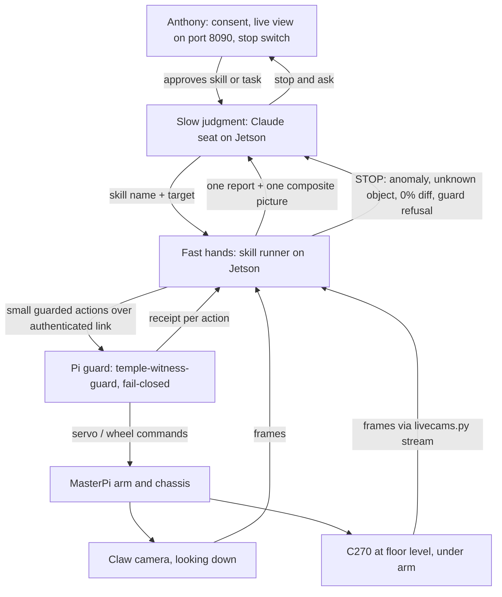

# Motion Skills Spec: Fast Hands, Slow Judgment

**Authors:** Anthony J Vasquez Sr, with Claude (co-author). Drafted by a Claude web research seat on 2026-10-15 from Anthony's brief; verified and corrected against this branch by HQ (Claude Fable 5.1, Mac Studio Claude Code seat) the same day.
**Status:** Proposal. Documentation only. Nothing here changes code, deploys anything, arms the robot or moves it.
**Branch:** prep/pi-guard-service (verified at 67f12fd)
**Reviewer:** HQ

**Verification status.** The drafting seat could not open the repo and tagged every repo-specific fact for checking. HQ checked each one against the branch at 67f12fd on 2026-10-15 and against the opus-02 notes on the Jetson. Where a file disagreed with the draft, the file won and the text below is corrected. Two kinds of tag remain: **[opus-02, Jetson only]** marks a figure whose source is the opus-02 notes under `jetson:~/witness-opus-notes/opus-02/`, which are not yet in this repo; **[re-measure]** marks a figure that no record carries yet. Appendix A lists every check with its file and line.

## 1. Problem

Today a large Claude model sits inside every tiny arm move. One batch is usually one joint, one small step. Each batch requires:

1. a status read within 2 s;
2. a battery check;
3. a runtime systemd override at `/run/systemd/system/temple-witness-guard.service.d/commissioning.conf` that changes `ExecStart`, plus a guard restart to arm (PASSDOWN.md, section on the 10-13 cleanup);
4. the action;
5. capture of both camera frames;
6. Claude reviewing both frames before choosing the next move;
7. cleanup in a `finally` block: stop, disarm, remove the override, restore the normal `ExecStart`.

Anthony approves each step at the switch.

**Measured cost:**

| Session | Date | Batches | Result |
|---|---|---|---|
| opus-01 | 2026-10-13 | 82 batch entries in `receipts/opus-01/session.json` (98 receipt files in `receipts/opus-01/batches/`, dry runs and drive pulses included) | Green held on the fourth grasp attempt (20:16 EDT); the first stack attempt dropped it beside red; regrabbed at 20:35; first stack (green on red) at 20:42 EDT |
| opus-02 | 2026-10-14 | 65 batch receipts on the Jetson (one dry), 21:29 to 22:35 EDT **[opus-02, Jetson only]** | No stack. Halted half-awake once for an unknown object at the C270 lens; claw camera out of focus until refocused mid-session; jaws landed short on every grasp |

That is roughly one minute per batch. Most of the minute goes to ceremony and model review, not motion. Guard restarts were also where most "serial ownership changed" startup refusals happened (four in opus-01, three of them on the connect right after an override restart). The scanner fix (7a12d2e, release 20261013-scanner-01) is live on the Pi (`receipts/scanner-deployed.json`). PASSDOWN.md calls the existing scripts evidence, not a production commissioning API (line 400), and lists making the commissioning harness dependable as the first follow-up (line 470).

The worst cost is a lesson that did not stick. On Oct 13, Anthony saw with his own eyes that the jaws land about 2 in (5 cm) short of the claw camera's aim point, toward the robot (`receipts/opus-01/LEARNING.md`, GROUND TRUTH 20:1x). The same miss recurred all night on Oct 14, because the lesson lived in notes and not in code.

## 2. Architecture

Three layers, each with one job:

- **Fast hands (Jetson, code, no LLM):** deterministic skills. Each runs its own closed loop: command a small move, grab fresh frames, measure, decide the next small move or stop. These checks run continuously inside the skill.
- **Slow judgment (Claude seat on the Jetson):** chooses the skill and target ("grab green, stack on red"). After each skill it reads one short report and one composite picture, then decides the next skill, or stops and asks Anthony. It handles anything anomalous.
- **Safety floor (Pi guard, unchanged in this spec):** fail-closed, disarmed by default, battery floor 7000 mV (`companion/pi/service.py` default), wheel duty limit 0 (`deploy/hardware-locked.json`, installed as `/etc/temple-witness/hardware.json`, enforced in `companion/pi/hardware.py`), all four vendor units masked (DEPLOYMENT.md, "Vendor retirement and boot behavior"). No automatic action retry (PASSDOWN.md line 468), no replay of historical runners (line 402), a receipt for every action, and finally-block cleanup.

**Why this split.** Published LLM-robot systems keep the language model above a set of skills. SayCan grounds an LLM in a library of skills, each with a policy and a short language description, and scores what is feasible. Code as Policies has the LLM write programs that call perception outputs and control-primitive APIs. Inner Monologue returns success-detection and scene-description feedback to the planner after each skill. VoxPoser has the LLM compose objectives that a motion planner then executes in closed loop. Bin Xu's survey "AI Agent Systems: Architectures, Applications, and Evaluation" (arXiv:2601.01743) states the reason: "Real-time control imposes strict timing constraints that LLM inference cannot always meet." Its recommended pattern is "hierarchical orchestration: a high-level planner maps language goals to skill plans... and specialized controllers execute primitives under constraints." The same survey says hard constraints "must be enforced regardless of language intent". Here, that is the Pi guard's job.

**What this does not change.** The Pi guard's code, limits and defaults. The authenticated link. Anthony's ownership of motion consent.

## 3. Skill catalogue

### 3.0 Rules every skill follows

- **Fresh frames only.** Read the newest frame. Never act on a buffered one. OpenCV capture can queue stale frames when processing is slower than the camera. Refuse frozen frames, as the opus-01 and opus-02 runners already do (opus-01 G29 stopped on "stale claw frame").
- **C270 warm-up.** Discard the first 15 to 30 frames, which are black during auto-exposure. Then require mean brightness above a floor (opus-01 lowered the floor from 20 to 8 after a false dark stop; warm-up black reads about 2). Manual exposure control on Logitech webcams through OpenCV is unreliable on several platforms, so check brightness instead of trusting a setting.
- **Motion witness.** Every commanded move is followed by a claw-camera image diff. A held joint shows about 0% change, and a move shows a large change (40% in opus-01). **0% change after a commanded move is STOP** (stall, contact or backlash), never progress. The one exception is the grasp close steps, where 0% means the jaws met the block (see grasp).
- **Step budget.** Every skill has a maximum number of moves and a maximum wall time. If it runs out of either, it stops and reports. It does not keep trying.
- **No retry of a refused action.** If the guard refuses or errors on an action, the skill stops at once. A closed loop issues new moves computed from new frames. It never re-sends a failed command. (Whether closed-loop stepping fits the "no automatic action retry" rule in PASSDOWN.md is an open question for Anthony. See section 9.)
- **Unknown object means stop and ask.** Any significant blob near the arm in either camera that is not a known block colour stops the skill: hands, socks, toys, anything. The skill does not try to classify it. This keeps the operator call that halted opus-02 half-awake for a plush toy at the C270 lens, which could have been a child's foot.
- **Scene-change refusal.** Before any move, the runner compares the fresh frame with its own previous frame; a large change the runner did not command (something entered the scene) is a stop. Proposed by the opus-02 seat after the plush toy; not yet implemented. **[opus-02, Jetson only]**
- **No blind close.** The gripper never closes unless the grasp-range check passes. And the jaws are opened to 2000 before every final approach: opus-01's tower attempt caught jaws left at 1800 after a release, which a 45-degree block's diagonal (about 4.2 cm) may not clear.
- **Receipts.** Every action gets a guard receipt. Every skill writes one skill receipt: inputs, constants used (with config version), each step's command, diff %, gate results, stop reason and the composite picture path.
- **Constants come from config.** No measured number is hard-coded in a skill. See section 6.

### 3.1 Measured constants the skills encode

Verified against `receipts/opus-01/LEARNING.md` unless marked otherwise.

| Constant | Value | Used by |
|---|---|---|
| Servo channels | 1 gripper, 3 wrist pitch, 4 elbow, 5 shoulder, 6 base yaw (CAPABILITIES.md line 32; `receipts/vendor-mapping-facts.json`, where roles 3/4/5 are inferred from the installed IK equations and 6 is explicit in source). **There is no wrist roll on this arm.** | all |
| Pulse range | 500 to 2500 us nominal on channels 3 to 6 after the software offset (`companion/arm_lift.py`, `vendor-mapping-facts.json`); the opus-01 runner refused shoulder 2516, so 2500 is the runner ceiling too | all |
| Wake order | shoulder, elbow, base, gripper, wrist | wake_arm |
| Base gain | +50 us moves the claw view about 65 px right (high, full-res) | center_on |
| Yaw gain vs height | about 2.4 px/us full-res when low (shoulder 2496), about 0.65 px/us high; re-measure after every height change | center_on |
| Shoulder gain | +100 us moves the view about 45 px up and the gripper lower; about 2 cm per 100 us and it pulls the gripper back | approach |
| Elbow gain | +100 us moves the view about 120 px up; elbow+ also pulls the gripper back toward the robot | approach |
| Wrist gain | +100 us moves the view about 110 px down (jaws tilt outward); C270 jaw barely moves | approach |
| Reach | vertical-gripper reach at block height about 12 cm from base | locate_blocks, approach |
| Elbow backlash | about 100 us or more under load on reversal (G8/G9: 200 us of decrease with 0% change) | approach, place_on |
| Aim offset | jaws land about 2 in (5 cm) short of the claw aim point, toward the robot; opus-02 saw more than 2 in at some base/wrist settings **[opus-02, Jetson only]** | approach |
| Grasp point vs wrist | wrist 782 (vertical): image centre; wrist about 1200 (tilted): near the bottom, between the jaw tips | center_on, approach |
| Close steps | 2000, 1800, 1600, 1400; runner gripper floor 1400 | grasp |
| Open range | 1400 to 1800 on release; open to 2000 before a final approach | release, grasp |
| Jaw-angle rule | the block's faces must be roughly parallel to the jaws; a corner-first close pivots the block out (0 of 2 on rotated blocks, 2 of 2 square) | square_block, grasp |
| C270 straddle dead zone | the C270 can judge the straddle only for blocks more than about 2.5 in from its lens; the jaws grasp at about 1 in. Source: the opus-02 seat's close, not its learning log. **[re-measure]** | grasp |
| C270 warm-up | first 15 to 30 frames black | all C270 reads |
| Drive pulse | duty 20, 0.5 s moved about 2 in once on the rug; two pulses overshot to about 10 cm | not a skill yet (see 3.12) |
| Battery drop under arm work | about 115 mV over 9 batches, 235 mV over 26, 291 mV over 50 **[opus-02, Jetson only]** | session budgeting |

### 3.2 wake_arm

- **Inputs:** none.
- **Preconditions:** guard reachable; battery check passes (with the freshness rule in section 4); both cameras live and not frozen; no unknown object in view.
- **Closed loop:** joints sag when unpowered. Wake one joint at a time in the order shoulder, elbow, base, gripper, wrist. Choose each target from the cameras, near the current sagged pose, not from a stored pose (opus-01 A2: waking to the last commanded pose moved the elbow several cm). Confirm each joint with a diff before moving to the next.
- **Stop conditions:** 0% diff after a wake command; a large unexpected jump; a guard refusal; an unknown object.
- **Outputs and receipt:** pose reached per joint; per-joint diff %; composite of before and after.

### 3.3 locate_blocks

- **Inputs:** colours of interest (red, green, blue).
- **Preconditions:** C270 past warm-up and above the brightness floor.
- **Logic (no motion):** HSV threshold per colour, then morphology, then contours. Keep blobs that pass area, aspect and solidity checks for a block. Report the bbox, centre and pixel width for each block in each camera. Flag blocks beyond about 12 cm reach as "out of reach". Flag rotation (minimum-area rectangle angle).
- **Known limits:** HSV separates hue from brightness but is not illumination-proof. Hue is unstable near grey, and it breaks under coloured light and sensor saturation. Rugs are often low-saturation and textured. Red wraps around hue 0, so it needs two ranges. The sonar LEDs tint things blue in the C270 (opus-01 stack attempt 1). Treat colour as a candidate, and confirm by shape and size.
- **Stop conditions:** two candidate blobs for one colour; a blob of unknown colour above the area floor near the arm; brightness out of range.
- **Outputs:** list of blocks with colour, bbox, width, angle, reachability and confidence; annotated composite.

### 3.4 center_on(color)

- **Inputs:** target colour; current wrist value.
- **Preconditions:** locate_blocks found exactly one block of that colour.
- **Closed loop (IBVS):** the target point in the claw view is the **grasp point for the current wrist tilt**, not the image centre (centre at wrist 782; near the bottom between the jaw tips at about 1200). Error = block centre minus grasp point. Base yaw corrects left and right using the height-dependent gain. Re-estimate the gain from the first measured move at each new height rather than trusting the table. Use small capped steps, with a diff after each.
- **Stop conditions:** error inside tolerance (success); 0% diff after a move; block lost; step budget hit; unknown object.
- **Outputs:** final pixel error; gain actually measured; composite.

### 3.5 approach(color)

- **Inputs:** target colour.
- **Preconditions:** center_on succeeded; block reachable; jaws open to 2000.
- **Closed loop:** lower and extend with shoulder, elbow and wrist using the sign and gain table. **Built-in aim offset:** aim the claw view about 5 cm beyond the block, away from the robot, because the jaws land that far short. In opus-01 the working form of the offset was one forward drive pulse after centring at the low pose, then raise and descend again; expressing it as pixels per height is bench-calibration work **[re-measure]**. Approach the final position from one consistent direction for each joint, so elbow backlash is always taken up the same way. Standard backlash handling is either to approach from one side or to add the deadband value whenever direction reverses. Re-centre between steps. Use the C270 jaw size as the depth cue (bigger means nearer the robot).
- **Stop conditions:** 0% diff; elbow reversal needed late in the approach (stop and report rather than reverse blind); reach limit; a jaw tip sitting at block-top height in the C270 beside the target (a further descent lands on the block edge); unknown object.
- **Outputs:** final joint values; whether the grasp-range check can see both jaw tips; composite.

### 3.6 square_block

- **Inputs:** target colour; block angle from locate_blocks.
- **Why:** the method worked square-on (2 of 2) and failed on rotated blocks (0 of 2 at about 30 and 45 degrees). Closed-jaw nudges to square a block missed in both opus-01 and opus-02: the finger lands short, the same offset as the grab.
- **What this arm cannot do:** channel 3 is wrist pitch, not roll (CAPABILITIES.md line 32, `vendor-mapping-facts.json`). The jaw angle in the floor plane is set by base yaw alone, so the jaws can only be aligned to a rotated block if the block happens to sit on the ray the base would have to point along. There is no general "rotate the jaws to match" move.
- **Proposed logic:** if the block angle is inside tolerance, pass. Otherwise report "rotated, needs human or new method" and stop. Do not nudge blind. A nudge method stays out until it is designed with the aim offset built in and passes the bench tests.
- **Stop conditions:** angle above a threshold; 0% diff.
- **Outputs:** measured angle; composite.

### 3.7 grasp(color)

- **Preconditions:** approach succeeded; the target has a jaw-width gap on both gripping sides (opus-01 GROUND TRUTH 20:0x: red and blue touched, the right jaw was blocked); gripper open to 2000.
- **Pre-close gates (all must pass):**
  1. **C270 straddle gate:** the block's full width sits between the jaw inner edges. This caught the short reach repeatedly on Oct 14 and prevented every blind close. **[opus-02, Jetson only]**
  2. **Grasp-range check (new, covers the C270 dead zone):** both jaw tips visible in the claw view with the block between them. If that cannot be judged, back up to a distance the C270 can judge, verify, then come in again. This is the claw-view jaw-tip check the opus-02 seat proposed as its next bound.
- **Closed loop:** close in steps 2000, 1800, 1600, 1400. Diff after each step. A step with 0% change means the jaws stopped on the block, so hold that value (opus-01 attempt 4: the 1600 to 1400 step).
- **Stop conditions:** any gate fails; jaws reach 1400 with change on every step (empty close); an unknown object.
- **Outputs:** closing value at contact; gate results; composite including the C270 jaw view.
- **Never claimed:** "block barely moved on close" is not proof of a hold (opus-01 attempt 3, 5.9% change, block left on the floor).

### 3.8 verify_hold

- **Closed loop:** two small lifts. Hold is proven only if, on both lifts, the block's bbox stays fixed in the claw view while the background changes (opus-01: bbox x 175-539 to 181-531 while the far room came into view; grab 2: pixel area 72074 to 71171 while the scene changed 35 to 40%).
- **Stop conditions:** bbox moves with the background (slip or no hold); background does not change (the lift did not happen).
- **Outputs:** bbox drift per lift; background diff per lift; pass or fail.

### 3.9 place_on(color)

- **Preconditions:** verify_hold passed; target block located and reachable, with a jaw-width gap on both sides.
- **Closed loop:** centre over the target with the aim offset applied. Lower in small steps (50 to 100 us shoulder steps with small wrist corrections). Watch the held block's width in the claw view. **When the width jumps, the block has come to rest on the target. Stop lowering** (opus-01 stack 2: width held at 457-458 px through three steps, then jumped to 508 px at contact).
- **Stop conditions:** no width jump by the depth limit; 0% diff; target lost; unknown object.
- **Outputs:** depth at contact; width before and after; composite.

### 3.10 release

- **Closed loop:** open from about 1400 to 1800 in steps. For soft objects, yaw clear before lifting, because releasing with open jaws still in contact drags the object. Then lift.
- **Verify:** C270 shows jaws empty (two pad tips, nothing between), with the block on the target. Look for the held block's own colour in the C270, not just a shape.
- **Stop conditions:** object moved with the jaws; C270 cannot confirm.
- **Outputs:** verification result; composite.

### 3.11 retreat / park, and look

- **retreat/park:** lift first, then return to a park pose, one joint at a time, with diffs. **ARM_POSES.md defines no park pose.** It carries a planner reference start (3=754, 4=2485, 5=845, 6=1405) and the lift/reach corridor, nothing named park. opus-01 ended at 1=1400 3=1132 4=2353 5=1846 6=1345 with the pads lifted off the rug; opus-02 ended folded and disarmed. The park pose should be chosen at the next attended session and written to the constants file (section 6), not pulled from ARM_POSES.md.
- **look:** no motion. Capture both cameras (after warm-up), build the composite, report brightness, focus (opus-02 ran most of the night with the claw camera at sharpness 4 against 93 after refocus) and frozen-frame status. Safe to run while disarmed. **[opus-02, Jetson only]** for the sharpness figures.

### 3.12 Driving is out of scope

One pulse (duty 20, 0.5 s) moved about 2 in on the rug once, and two pulses overshot. Rug drag makes commanded distance untrustworthy. No drive skill is proposed until travel can be verified by camera. The wheel duty limit stays 0 (`deploy/hardware-locked.json`) unless a commissioning override installs a different hardware file.

### 3.13 Report format back to Claude

One JSON report per skill: `skill`, `target`, `result` (ok / stopped / refused), `stop_reason`, `steps`, the key measurements, `constants_version` and `composite_path`. The composite is one image: claw before and after, plus C270 before and after, annotated with bboxes, grasp point and jaw edges.

## 4. Arming model

**Today:** one override, one restart, one arm and one cleanup per batch.

**Proposed:** one commissioning session per skill. Install the override once, restart the guard once and arm once. Run all of the skill's small guarded actions. Then run the cleanup `finally` once: stop, disarm, remove the override, restore `ExecStart`.

How fail-closed stays intact:

- The guard still checks every single action: limits, battery, the authenticated link. Nothing about per-action checking changes.
- The session is bounded. It ends on skill completion, skill stop, guard refusal, error, timeout or Ctrl-C. Every exit path runs the same `finally`.
- If the skill process on the Jetson dies mid-session, the guard must end up disarmed. This needs a liveness rule the harness alone cannot provide (see guard changes).

**Harness-only changes (Jetson side, no guard change):**

- A session wrapper that opens one commissioning session per skill and guarantees the `finally` cleanup.
- The skill runner, step budgets, frame freshness checks and composite and report writer.
- Receipt aggregation: one skill receipt that links to each guard receipt.
- Battery stopgap until the guard fix lands: distrust two identical or rising readings under load, and re-read (already in the opus-02 session plan's preconditions).

**Guard changes (Pi side, need HQ review, separate PRs, not in this one):**

1. **Battery freshness fix (required before skill-level arming).** Known bug: the battery sample is stamped at status-call time while the SDK queue keeps the oldest packet, so the freshness gate can pass on a stale reading during arm work. A fix is staged on the Jetson at `jetson:~/witness-opus-notes/battery-stamp-fix/` (patch, red and green tests, patched copy) and is not applied to either tree; it waits on HQ review and, per the 10-13 permission, Codex applies it. Skill-level arming must not start until it is merged and tested. Before then, only the stopgap above applies, and only to per-batch work.
2. **Session limits.** A per-arming action budget and a wall-clock expiry. The guard disarms itself when either runs out, even if the Jetson never sends cleanup.
3. **Liveness (dead-man).** If the guard hears nothing from the session holder for N seconds while armed, it stops and disarms.
4. **Later option, not proposed now:** replacing the `ExecStart` override and restart with a guard-native arming request. This would remove restarts, the place where the "serial ownership changed" refusals clustered. It is a bigger change to the safety floor and deserves its own spec.

## 5. Consent model (Anthony's decision)

**Prior decisions.** No standing ruling was found, in Anthony's standing policies or the chronicle, on how much motion one approval covers. Every session so far ran per-batch, with Anthony approving each step. A passdown noted that cheering is not wider motion consent.

| Option | One approval covers | Gain | Risk |
|---|---|---|---|
| A. Per batch (today) | one small move | maximum oversight | slow; about 1 min per move |
| B. Per skill | one skill, e.g. "grasp green", bounded by its step budget | far fewer approvals; skill stop rules still apply | several moves happen between approvals |
| C. Per task | a sequence, e.g. "stack green on red" | fastest | many moves; relies most on skill stops |

In every option, Anthony watches the live dual-camera page (port 8090) and holds the stop switch. Any skill stop, unknown object or guard refusal returns control to him. Cheering or encouragement never widens consent, and refusing a blind grab stays correct even when encouraged.

**Recommendation (for Anthony to accept or reject):** stay on A for the first replay and unloaded stages. Move to B only for attended grasps once the negative controls pass. Consider C only after a run of clean per-skill sessions. Nothing in this spec assumes B or C.

## 6. Memory

- **One cumulative lessons file** (proposed: `docs/hq/ARM_LESSONS.md`) that the Jetson seat reads first in every session. It merges `receipts/opus-01/LEARNING.md` and the opus-02 lessons. **The opus-02 LEARNING.md is not in the repo** (no file on this branch mentions opus-02; it lives at `jetson:~/witness-opus-notes/opus-02/LEARNING.md`). Committing it is a prerequisite.
- **One constants file** (proposed: `config/arm_skills.yaml`) that the skills read: gains, offsets, close steps, thresholds, the park pose, each with source session and date, and a version number stamped into every skill receipt.
- **Promotion rule:** a lesson that changes behaviour must become code or config with a test, not stay a note. The 2-inch aim offset is the example to follow.

## 7. Test plan

House rules: a check that cannot fail is not a check, and an instrument must beat a trivial baseline, not just chance.

1. **Bench replay (no hardware).** Replay recorded frames through each skill's perception. **Where the frames are:** opus-02's 378 frames and 65 batch receipts are on the Jetson under `~/witness-opus-notes/opus-02/`; opus-01's receipts in this repo (`receipts/opus-01/batches/`, 98 JSON files) carry no frames, and only the first-stack photo is committed, so whether opus-01 frames survive on the Jetson is open (section 9). Labels come from the receipts and Anthony's notes. Baselines: for the motion witness, the diff distribution of held-joint frame pairs. For straddle, "always say not straddled" and "always say straddled". For locate_blocks, a fixed-centre guess. Each instrument must beat its baseline.
2. **Fake-board tests.** A fake guard and board that record commands and can inject refusals, stale battery readings, frozen frames and black frames. They confirm budgets, the `finally` cleanup on every exit path, and that no refused action is re-sent.
3. **Negative controls, one per stop condition**, each of which must fail closed:
   - frozen frame, black C270 frame, low brightness, out-of-focus claw frame;
   - 0% diff after a commanded move (held-joint frame pair fed as a "move");
   - straddle-gate fail (Oct 14 short-reach frames);
   - grasp-range check fail (block outside the jaw tips);
   - verify_hold where the bbox moves with the background;
   - unknown object (frames with a non-block object near the lens; the opus-02 plush-toy frames exist);
   - scene change the runner did not command;
   - stale battery (two identical or rising readings under load);
   - guard refusal mid-skill; session expiry; Jetson process killed mid-session (guard must disarm).
4. **Attended unloaded motion.** Anthony present, no block in the gripper, per-batch consent: wake_arm, look, center_on, approach to a marker, park.
5. **Attended grasps.** Square-on blocks only, at first. Consent level per Anthony's decision in section 5.

## 8. Rollout and rollback

| Stage | What runs | Exit criterion |
|---|---|---|
| 0 | This spec merged (docs only) | HQ review |
| 1 | Lessons file + constants file + opus-02 LEARNING.md committed | HQ review |
| 2 | Bench replay + fake-board + negative controls | all negative controls fail closed; instruments beat baselines |
| 3 | Guard: battery fix, then session limits and liveness | HQ review; fake-board tests pass |
| 4 | Attended unloaded motion, per batch | clean receipts |
| 5 | Attended grasps, consent level per Anthony | first stack via skills |

**Rollback:** the skill runner is additive. The current per-batch path stays available until Anthony retires it. Reverting a stage means stopping use of the runner. The guard stays in its fail-closed default throughout. Guard changes ship as separate, revertible releases, and the current release stays installable.

## 9. Open questions for Anthony

1. Which consent unit for stage 5: per batch, per skill or per task?
2. Does a closed-loop skill issuing new moves from new frames count as "automatic action retry" under the guard rules (PASSDOWN.md line 468)? If yes, how should skills be framed instead?
3. What session expiry and action budget feel right for one skill?
4. What counts as "significant" for the unknown-object stop: any non-block blob, or a size floor?
5. ~~Can the wrist rotate the jaws for square_block?~~ Answered by the files: no. Channel 3 is wrist pitch; the arm has no roll joint. Squaring is a human job until a nudge method is designed and bench-tested.
6. Should guard-native arming (no restart) get its own spec now, given that restarts are where the serial-ownership refusals clustered?
7. Do opus-01 frames still exist on the Jetson? opus-02's do (378 files). The repo holds receipts only.
8. Where should the spec and lessons live: `docs/hq/` (where every HQ document on this branch sits) or a new `docs/` top level as the draft proposed? This file is placed under `docs/hq/` pending his word.

## 10. Research notes behind the design

- **LLM planner over skills:** SayCan (Ahn et al., arXiv:2204.01691, "Do As I Can, Not As I Say"), Code as Policies, Inner Monologue and VoxPoser all keep the model above skill primitives, and close the loop with success or scene feedback rather than per-joint control. The 84% planning / 74% execution figures the draft quoted for SayCan come from the paper body, not its abstract, and HQ did not re-read the body. RoboGuard (Ravichandran, Robey, Kumar, Pappas and Hassani, "Safety Guardrails for LLM-Enabled Robots", arXiv:2503.07885) is a "two-stage guardrail architecture" whose abstract states it "reduces the execution of unsafe plans from over 92% to below 3%" (HQ read the abstract). That is the role the Pi guard already plays.
- **IBVS on cheap arms:** "Visual servoing control of 4-DOF palletizing robotic arm for vision based sorting robot system", International Journal on Interactive Design and Manufacturing, online 2022 (doi:10.1007/s12008-022-01077-8; title and venue confirmed through Crossref, the full text sits behind a login). The draft quotes it as reporting real-time image processing on a low-cost embedded computer with no robot or camera calibration required.
- **Bin Xu, "AI Agent Systems: Architectures, Applications, and Evaluation"** (arXiv:2601.01743; title and sole author confirmed). The section 5.3.1 quotes are the draft's and were not re-read by HQ.
- **HSV on rugs and home lighting:** better than RGB for brightness changes, but not illumination-invariant. Weak near grey, under coloured light and at saturation. Use shape checks and stop on ambiguity. Re-check thresholds under evening lamp light.
- **OpenCV on the Jetson Orin Nano Super:** HSV thresholds, contours and frame diffs on two low-resolution streams are light CPU work. Stock pip OpenCV wheels are CPU-only, which is fine here. The real risk is stale buffered frames, not compute. Timing on this board is **[re-measure]** in stage 2.
- **Hiwonder vendor code:** the installed MasterPi IK is a geometric solver that drops base rotation and solves in a 2D plane; this repo already re-derived that geometry in `companion/arm_lift.py` (links 9.3, 6.5, 6.2, 10.0 cm from `receipts/vendor-mapping-facts.json`, read on the Pi and never copied). Do not import the vendor SDK or run its demos: the repo retired the vendor shortcuts and masked the four vendor units (DEPLOYMENT.md). The risks are bypassing the guard, link lengths that do not match this unit, and serial-port contention with the guard.
- **Backlash and deadband:** controllers compensate by adding the deadband value whenever direction reverses, or by always approaching from one side. Skills do the latter, and record reversal size in config.

## Appendix A. HQ verification of the draft (2026-10-15, branch at 67f12fd)

| Draft claim | Result | Where |
|---|---|---|
| Servo channels 1 gripper, 3 wrist, 4 elbow, 5 shoulder, 6 base yaw | Confirmed; channel 3 is wrist **pitch** (no roll) | CAPABILITIES.md:32; receipts/vendor-mapping-facts.json `pwm_roles_source` |
| Shoulder ceiling 2500 us | Confirmed as the runner range check and the nominal pulse maximum | receipts/opus-01/LEARNING.md:40; companion/arm_lift.py:21; vendor-mapping-facts.json `nominal_pwm_3_to_6` |
| Battery floor 7000 mV | Confirmed | companion/pi/service.py:30,116,225; DEPLOYMENT.md:25 |
| Wheel duty ceiling 0 | Confirmed | deploy/hardware-locked.json:2; companion/pi/hardware.py:105; DEPLOYMENT.md:94 |
| Override path and restart-to-arm | Confirmed | PASSDOWN.md:185-191 |
| "evidence, not a production commissioning API"; "make the harness dependable" | Confirmed | PASSDOWN.md:400, 470 |
| Vendor units masked, shortcuts retired | Confirmed | DEPLOYMENT.md:124-137; PASSDOWN.md:254-257 |
| Scanner fix 7a12d2e, release 20261013-scanner-01 | Confirmed | receipts/scanner-deployed.json |
| opus-01: 82 batch receipts, first stack 20:42 EDT after four grasp attempts | 82 entries in session.json (98 receipt files); first HOLD on attempt 4, stack 1 failed, regrab, stack at 20:42 | receipts/opus-01/session.json; LEARNING.md attempts 1-4, stack 1-2 |
| opus-02: 62 batches in a bit over an hour, no stack | 65 receipts (one dry), 21:29:08 to 22:34:41 EDT, no stack | jetson:~/witness-opus-notes/opus-02/ (not in repo) |
| Section 3.1 constants match LEARNING.md | Confirmed, with the dead-zone row re-sourced to the opus-02 close | receipts/opus-01/LEARNING.md |
| opus-02 LEARNING.md absent from the repo | Confirmed | no match for "opus-02" on the branch |
| Park pose in ARM_POSES.md | **Not there**; no park pose is defined anywhere on the branch | ARM_POSES.md (reference start only) |
| Wrist rotation for square_block | **Not available**; pitch only | CAPABILITIES.md:32 |
| Battery-freshness fix staged and awaiting HQ review | Confirmed, on the Jetson, not applied | jetson:~/witness-opus-notes/battery-stamp-fix/ |
| No automatic action retry; never replay a runner | Confirmed | PASSDOWN.md:468, 402, 474 |
| Four paper ids | All resolve to the cited titles; quoted figures inside the bodies not re-read except RoboGuard's abstract | arXiv abs pages; Crossref |

Authored by Anthony J Vasquez Sr, with Claude as co-author.
